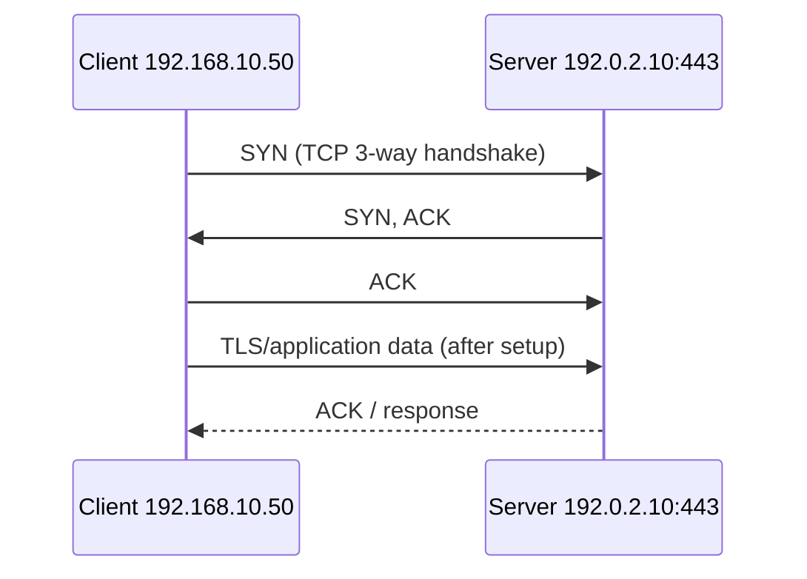
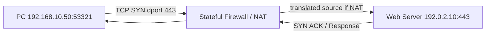

# TCP, UDP, Port Number এবং Connection | Theory + Practical

**Level:** Beginner → Junior NOC · **সময়:** 35–45 মিনিট

## 1. TCP/UDP কী এবং কেন দরকার?
IP packet-কে destination host পর্যন্ত পৌঁছাতে সাহায্য করে। কিন্তু একই host-এ web, SSH, DNS, video call একসঙ্গে চলতে পারে। **Transport layer**-এর TCP/UDP ও **port number** ঠিক করে কোন application data পাবে। `IP = building address`, `port = building-এর room number` (উপমা; বাস্তবে আরও অনেক বিষয় থাকে)। Source/destination IP এবং source/destination port মিলে একটি flow শনাক্ত করতে সাহায্য করে।

**TCP (Transmission Control Protocol):** connection-oriented; handshake, acknowledgements, ordered byte stream, retransmission, flow/congestion control আছে। **UDP (User Datagram Protocol):** connection setup ছাড়াই datagram পাঠায়; UDP নিজে delivery/order নিশ্চিত করে না। Application নিজে reliability যোগ করতে পারে (যেমন QUIC UDP-এর উপর চলে)। **TCP সবসময় দ্রুত/UDP সবসময় দ্রুত** বলা ভুল; workload এবং network conditions গুরুত্বপূর্ণ।

## 2. TCP বনাম UDP

| Feature | TCP | UDP |
|---|---|---|
| Connection | 3-way handshake | Transport-level handshake নয় |
| Delivery | retransmission ও ordered stream | কোনো inherent guarantee নেই |
| Overhead | তুলনামূলক বেশি | ছোট header: 8 bytes |
| Usage example | SSH, HTTPS over HTTP/1.1 or 2, SMTP | DNS সাধারণ queries, VoIP media, DHCP, NTP |
| Note | Congestion এ latency বাড়তে পারে | QUIC/HTTP3 UDP ব্যবহার করেও reliable transport দেয় |

**Common Ports:** HTTP TCP/80; HTTPS TCP/443 (HTTP/3 QUIC UDP/443); DNS UDP/53, TCP/53; SSH TCP/22; DHCPv4 UDP/67 server, UDP/68 client; NTP UDP/123; BGP TCP/179; SNMP UDP/161, traps 162; RADIUS UDP/1812 auth, 1813 accounting; SMTP TCP/25, 587 submission (TLS policy)। এগুলো **default ports**, service configuration-এ বদলাতে পারে।

## 3. Port ও firewall বোঝার example
Client `192.168.10.50:53321` → Web Server `192.0.2.10:443`। Client-এর `53321` ephemeral/source port। Return path-এ source/destination ports উল্টে যায়। Stateful firewall connection tracking করে এই return packets মেনে নিতে পারে।

## 4. Hands-on diagnostic
Windows: `Test-NetConnection example.com -Port 443`, `netstat -ano`; Linux: `ss -tulpen`, `nc -vz example.com 443`, `dig example.com`; MikroTik: `/tool sniffer quick ip-protocol=tcp port=443` (available flags differ by release); Cisco: `show access-lists`, `show ip interface brief`। ICMP ping success মানেই TCP/443 open নয়; ping fail মানেই website down নয়।

## 5. Troubleshooting (উদাহরণ)
1. DNS ঠিক resolve করছে কিন্তু TCP timeout? Route, ACL, stateful firewall, upstream drop পরীক্ষা।
2. TCP `Connection refused`? Destination পৌঁছেছে, কিন্তু port-এ service listen করছে না অথবা reject করছে।
3. UDP DNS timeout? UDP/53, DNS service, EDNS, TCP fallback, firewall ও resolver পরীক্ষা।
4. Video call-এ jitter? latency variation, packet loss, bufferbloat ও QoS দেখো।

## Viva / Think
- **Q:** UDP কি সবসময় unreliable application তৈরি করে? **A:** UDP transport guarantee দেয় না; app protocol reliability যোগ করতে পারে।
- **Q:** SSH port? **A:** Usually TCP/22।
- **Q:** TCP handshake? **A:** SYN → SYN/ACK → ACK।
- **Q:** TCP/443 খুললে HTTP/3 চলবে? **A:** HTTP/3 সাধারণত UDP/443-এ চলে।
- **Q:** BGP কোন protocol/port? **A:** TCP/179।

**Read next:** [OSI deep walk-through](07-osi-packet-walkthrough.md) · [DNS](../05-services/03-dns-records-troubleshoot.md).

**References:** [RFC 9293 (TCP)](https://www.rfc-editor.org/info/rfc9293/) · [RFC 768 (UDP)](https://www.rfc-editor.org/info/rfc768/) · [IANA Service Names](https://www.iana.org/assignments/service-names-port-numbers/service-names-port-numbers.xhtml).
