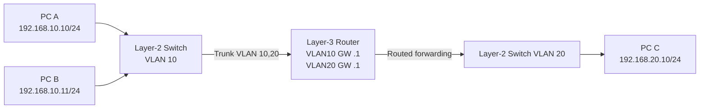

# Layer 2 vs Layer 3, Uplink vs Downlink, LAN vs WAN

## Layer 2 (Data Link)
Ethernet frame, **source/destination MAC**, switching/bridge, VLAN, ARP interaction, STP। সাধারণ switch তার MAC table দেখে একই VLAN-এর frame forward করে। L2 switch অন্য IP subnet-এর gateway হিসেবে কাজ করবে না (management IP থাকতে পারে কিন্তু তা L3 routing capability নয়)।

## Layer 3 (Network)
IP packet ও **source/destination IP** দেখে router route lookup করে। VLAN 10 `192.168.10.0/24` ও VLAN 20 `192.168.20.0/24`-এর মধ্যে যোগাযোগ করতে L3 gateway এবং routing/ACL দরকার। L3-capable switch SVI/VLANIF বা routed port দিয়ে এই কাজ করতে পারে।

**Traffic:** A→B is same subnet: ARP B, switch forwards frame. A→C: A ARPs **default gateway** MAC (not PC C MAC), sends to router, router decrements TTL and forwards to VLAN20. Egress frame has new L2 MAC addresses but (without NAT) same source/destination IP।

## LAN vs WAN
- **LAN:** privately managed local network, often Ethernet/Wi‑Fi; IP may be public or private though private is typical।
- **WAN:** wide-area interconnect/service; could be Ethernet handoff, leased line, MPLS, broadband, optical P2P, radio etc। `WAN` always Internet নয়: private corporate WAN হয়।
- **Uplink/Downlink:** Topology-এর perspective relative. ONU→OLT is upstream/uplink from subscriber; OLT→ONU downstream/downlink. A switch uplink toward aggregation, downlink toward access/customer। Fiber has separate TX and RX directions; report direction + interface explicitly।

## Broadcast, Collision, VLAN
- Broadcast domain generally each VLAN/L2 segment; routers separate broadcast domains।
- Collision domain per switched full-duplex port in classic Ethernet model; modern full duplex collisions normally absent।
- STP blocks redundant L2 paths to prevent broadcast storms; routing protocols can use alternate L3 paths without L2 loops।

## Troubleshooting map
| Symptom | First likely layer/check |
|---|---|
| Link down | L1: cable, SFP, laser, interface admin |
| Same VLAN PC unreachable | L2: VLAN, MAC, ARP, security, host firewall |
| Different VLAN unreachable | L3: gateway, SVI, route, ACL, return route |
| Internet IP reachable but website fails | L7 DNS or HTTPS/application |
| Congestion | Utilization, queue, discards, packet loss |

## Viva
- **Q:** L2 forward key? **A:** Destination MAC + VLAN।
- **Q:** Router lookup key? **A:** Destination IP, routing table।
- **Q:** Gateway কেন? **A:** Off-subnet traffic next hop।
- **Q:** Uplink কি সবসময় faster? **A:** No, design capacity অনুযায়ী।
- **Q:** WAN মানেই public IP? **A:** No।

**Related:** [L2/L3 switch practical](../03-switching/05-l2-l3-switch-intervlan.md).
