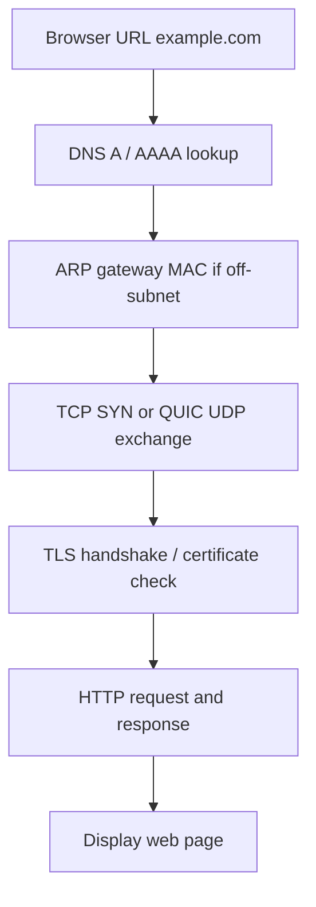
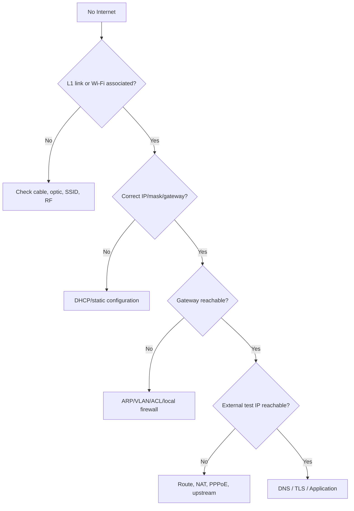

# OSI Model: Seven Layers + Real Packet Walkthrough

## OSI Model মানে কী?
OSI (Open Systems Interconnection) হলো networking function বোঝানোর **7-layer reference model**। TCP/IP stack operational model; protocol implementations সবসময় textbook layer boundary মেনে চলে না। Troubleshooting-এ layer-by-layer thinking খুব useful।

| OSI Layer | কাজ | Common technology | Troubleshooting question |
|---|---|---|---|
| 7 Application | User-facing protocol | HTTP, DNS, SMTP, SSH | App/resolver working? |
| 6 Presentation | Representation/encoding, encryption concepts | TLS/encoding (not strict 1:1) | TLS/cert/format issue? |
| 5 Session | Session control concept | App sessions/RPC | Session establishment? |
| 4 Transport | TCP/UDP, ports, reliability | TCP, UDP, QUIC over UDP | Port/handshake/retransmission? |
| 3 Network | IP addressing & route | IPv4/IPv6, ICMP | IP, gateway, route, TTL? |
| 2 Data Link | Ethernet frame & MAC, VLAN | Ethernet/802.1Q | MAC, trunk, ARP, STP? |
| 1 Physical | Bit transmission | Copper, SMF/MMF, optic | LED, RX/TX dBm, cable? |

**PDU naming:** L4 segment (TCP)/datagram (UDP), L3 packet, L2 frame, L1 bits। Practical engineers often say “packet” generically; formal layers helpful for isolation।

## Example: Home PC → Internet website
1. Laptop connects to Wi-Fi, DHCP gives `192.168.50.100/24`, gateway `192.168.50.1`, DNS resolver।
2. Resolver obtains a website A/AAAA record; DNS answer alone is not a connectivity guarantee।
3. Destination is outside LAN: laptop ARPs gateway MAC (IPv6 uses Neighbor Discovery)।
4. Wi-Fi/L2 frame reaches home router. Router looks up destination route and usually NATs IPv4 private source to WAN address।
5. Upstream routers forward by longest prefix match; return traffic follows a valid return path and NAT connection mapping।
6. For HTTPS, TCP+TLS or QUIC+TLS establish application communication. Browser renders content।

## Decision flow: What if Internet doesn't work?

## Tools at each layer
L1: LED, optical DDM, cable tester; L2: `show vlan`, `show mac address-table`, `/interface bridge host print`; L3: `ipconfig`, `ip route`, `ping`, `traceroute`; L4: `ss`, `Test-NetConnection`, packet capture; L7: `nslookup`, `dig`, `curl -Iv`।

## Mistakes to avoid
- *Ping pass মানে সব pass*: ping ICMP, browser TCP/UDP+TLS+DNS দরকার।
- *Packet loss ping-এ always fiber fault*: congestion, ICMP rate-limit, host firewall cause হতে পারে।
- *MAC address globally routes*: MAC L2 local segment; inter-router path-এ frame rewritten।

## Viva
1. **Q:** Physical layer? **A:** Bits signalling media।
2. **Q:** IP layer? **A:** L3।
3. **Q:** VLAN tagging কোন layer? **A:** L2।
4. **Q:** TCP কোন layer? **A:** L4।
5. **Q:** DNS কোন layer? **A:** Application layer।

**References:** [RFC 1122](https://www.rfc-editor.org/info/rfc1122/) · [OSI/TCP-IP existing introduction](02-osi-tcp-ip-and-packets.md).
