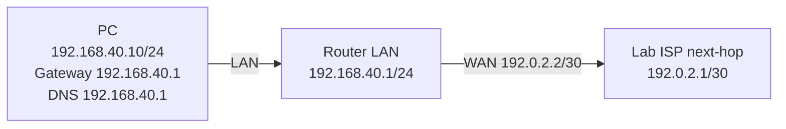

# Static IP, Dynamic IP, Gateway, Mask, DNS: Beginner Deep Dive

## 1. পাঁচটি তথ্য না বুঝে network configure নয়
A typical host uses: **IP address** (host identity per subnet), **subnet mask/prefix** (local subnet boundary), **default gateway** (off-subnet next-hop), **DNS server** (name lookup), **addressing method** (static/manual or DHCP/dynamic)।



## 2. Static IP কী?
Admin manually IP/mask/gateway/DNS সেট করে। Server, management interfaces, stable router links, printers (or DHCP reservations) দরকার হতে পারে। Static **IP address** আর static **route** আলাদা: প্রথমটা interface address; দ্বিতীয়টা routing table path। Static IP মানেই public/fast নয়।

**Lab PC:** `192.168.40.10/24` gateway `192.168.40.1` DNS `192.168.40.1` (router DNS resolver on হলে)।

## 3. Dynamic IP কী?
DHCP server থেকে একটি lease হিসাবে address, mask, gateway, DNS আসে। Dynamic client DHCP renew করলে একই address আবার পেতে পারে; automatic মানেই প্রতিবার new IP নয়। **Dynamic WAN DHCP** (ISP router থেকে) বনাম **LAN DHCP** (home router client-কে দেয়)। DHCP reservation = centrally managed fixed assignment by MAC/client ID; manual static different mechanism।

## 4. IP decision: same subnet / remote subnet
`192.168.40.10/24` থেকে `192.168.40.20` local; gateway লাগে না। `192.168.50.20` remote; default route বা specific route-এর next-hop লাগে। Gateway IP local L2 adjacency/reachability থাকা প্রয়োজন; “gateway .254 দিলেই চলবে” নয়।

| Config error | Symptom | Check |
|---|---|---|
| Wrong mask | Some peers wrongly treated local/remote | prefix and ARP |
| Wrong gateway | Same LAN works, Internet fails | `ip route`, ping GW |
| Duplicate IP | Intermittent connectivity / ARP flips | ARP/DHCP lease/conflict logs |
| Wrong DNS | IP reachable, name fails | `nslookup`, `dig` |
| Static WAN IP with DHCP client simultaneously | Routes/addresses conflict | choose one WAN mode |

## 5. Host practice
Windows PowerShell (admin; adapt interface):
```powershell
Get-NetAdapter
New-NetIPAddress -InterfaceAlias "Ethernet" -IPAddress 192.168.40.10 -PrefixLength 24 -DefaultGateway 192.168.40.1
Set-DnsClientServerAddress -InterfaceAlias "Ethernet" -ServerAddresses 192.168.40.1
Get-NetIPConfiguration
```
Return to DHCP (lab only; carefully remove existing static addresses/routes as appropriate):
```powershell
Set-NetIPInterface -InterfaceAlias "Ethernet" -Dhcp Enabled
Set-DnsClientServerAddress -InterfaceAlias "Ethernet" -ResetServerAddresses
ipconfig /renew
```
Linux temporary lab:
```bash
sudo ip addr add 192.168.40.10/24 dev eth0
sudo ip route replace default via 192.168.40.1 dev eth0
ip -br addr; ip route
```
Linux `ip` settings are **not persistent**; don't run over remote SSH without access plan। Use NetworkManager/Netplan for persistence on relevant distro।

## Viva
- **Q:** Default gateway mandatory for two same-subnet PCs? **A:** No।
- **Q:** Dynamic IP কে দেয়? **A:** Usually DHCP server।
- **Q:** Gateway can be remote IP outside local subnet? **A:** Normally host's gateway must be directly reachable on local link।
- **Q:** Static IP vs reserved DHCP? **A:** Host manual vs server-assigned pre-reserved lease।
- **Q:** DNS না থাকলে IP ping? **A:** Possible, if other connectivity okay।

**References:** [RFC 2131](https://www.rfc-editor.org/info/rfc2131/) · [Host IP setup](04-windows-linux-ip-setup.md).
