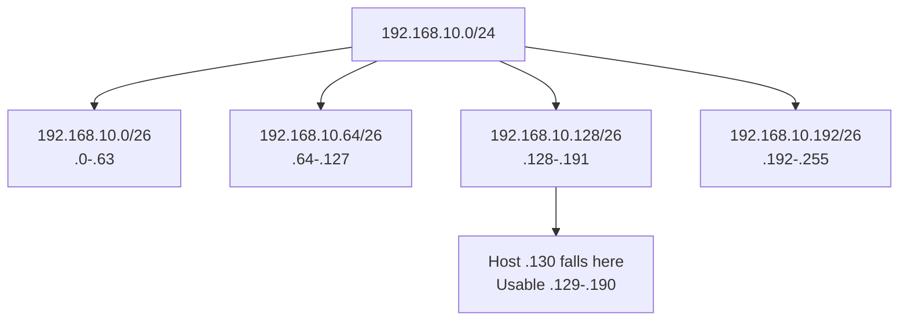

# IP Subnetting Workbook: CIDR, Host Calculation, VLSM + Answers

## 1. Network কেন ভাগ করি?
একটি `/24` subnet (256 total IPv4 addresses) কে ছোট network-এ ভাগ করলে broadcast scope, IP planning এবং departmental segmentation সহজ হয়। **CIDR prefix** tells how many leftmost bits are network portion, e.g. `/26` = mask `255.255.255.192`। `2^(32-prefix)` = total IPv4 addresses; conventional subnet usable host addresses = total−2 (network+broadcast), **except** special /31 P2P and /32 host uses।

## 2. Must-remember table
| Prefix | Mask | Total | Typical usable hosts | Block size in last octet |
|---|---|---:|---:|---:|
| /24 | 255.255.255.0 | 256 | 254 | 256 |
| /25 | 255.255.255.128 | 128 | 126 | 128 |
| /26 | 255.255.255.192 | 64 | 62 | 64 |
| /27 | 255.255.255.224 | 32 | 30 | 32 |
| /28 | 255.255.255.240 | 16 | 14 | 16 |
| /29 | 255.255.255.248 | 8 | 6 | 8 |
| /30 | 255.255.255.252 | 4 | 2 | 4 |
| /31 | 255.255.255.254 | 2 | 2 on RFC3021 P2P link | 2 |
| /32 | 255.255.255.255 | 1 | Single address/route | 1 |

## 3. Worked example 1: `192.168.10.130/26`
Mask final octet `192`; **block 256−192 = 64**। Network boundaries: `.0`, `.64`, `.128`, `.192`। Host `.130` lies in `.128–.191`। Therefore network `192.168.10.128`, first host `.129`, last host `.190`, broadcast `.191`, conventional usable 62।



## 4. Worked example 2: VLSM planning
You own lab network `10.10.20.0/24` and need **80 hosts, 40 hosts, 20 hosts, 8 hosts** plus two point-to-point router links। Sort largest first:

| Segment | Required hosts | Assigned | Usable conventional |
|---|---:|---|---:|
| Sales | 80 | `10.10.20.0/25` | 126 |
| Engineering | 40 | `10.10.20.128/26` | 62 |
| Accounts | 20 | `10.10.20.192/27` | 30 |
| Mgmt | 8 | `10.10.20.224/28` | 14 |
| Router link A | 2 | `10.10.20.240/31` | 2 (/31 P2P) |
| Router link B | 2 | `10.10.20.242/31` | 2 (/31 P2P) |

**Check:** /31 P2P requires endpoints support RFC 3021; otherwise allocate /30. Remaining `.244-.255` available for appropriate future allocation, but align network blocks।

## 5. Practice (আগে নিজে করো)
1. `172.16.5.73/27`: network, broadcast, usable range?
2. `192.168.100.205/28`: same four fields?
3. Need 25 hosts: smallest normal prefix?
4. `10.0.0.0/24` split into 8 equal subnets: prefix and network IDs?
5. `/30` vs `/31` on point-to-point link difference?
6. `192.168.1.1/25` and `192.168.1.200/25` same subnet?

<details><summary>Answers (click to reveal on GitHub)</summary>

1. `172.16.5.64/27`, broadcast `.95`, usable `.65-.94`.
2. `192.168.100.192/28`, broadcast `.207`, usable `.193-.206`.
3. `/27` (30 usable).
4. `/27`; `.0`, `.32`, `.64`, `.96`, `.128`, `.160`, `.192`, `.224`.
5. `/30` 4 total, 2 normal hosts; `/31` 2 addresses both endpoints usable in RFC3021 P2P.
6. No: first in `.0/25`, second in `.128/25`.

</details>

## 6. Easy tool
```bash
python3 scripts/subnet_calculator.py 192.168.10.130/26
# Above command assumes you are at repository root.
```
Check manually before tool. Note: IPv4 subnetting is not same as IPv6 where `/64` commonly used on host LAN; no broadcast address in IPv6।

**Viva:** What is CIDR? What is VLSM? /26 hosts? /29 mask? /31 special case? Explain to another intern without notes।

**References:** [RFC 4632 CIDR](https://www.rfc-editor.org/info/rfc4632/) · [RFC 3021 /31](https://www.rfc-editor.org/info/rfc3021/).
