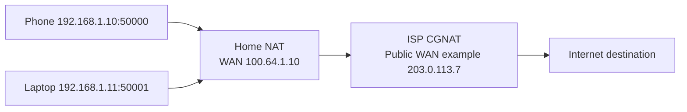

# Public IP, Private IP, CGNAT, NAT/PAT এবং Default Route

## IPv4 address types
| Group | Prefix/range | Typical use |
|---|---|---|
| RFC1918 private | `10.0.0.0/8` | Internal LAN / ISP private use |
| RFC1918 private | `172.16.0.0/12` | Internal LAN; *not* whole 172/8 |
| RFC1918 private | `192.168.0.0/16` | Home / SME LAN |
| CGNAT shared | `100.64.0.0/10` | Provider shared address space; **not** RFC1918 private |
| Link-local APIPA | `169.254.0.0/16` | Auto host self-assignment, generally no gateway |
| Loopback | `127.0.0.0/8` | Local host testing |
| Documentation-only | `192.0.2.0/24`, `198.51.100.0/24`, `203.0.113.0/24` | Examples, not public Internet test |

A **public IPv4** is an address usable for global routing *if validly assigned and advertised*; not every non-RFC1918 address is globally usable. Some ranges are reserved/special-use। ISP may provide static public, dynamic public, or private/shared WAN via CGNAT।

## NAT vs PAT
**NAT** maps address/port between networks. **Source NAT** changes source address; **destination NAT** changes destination, e.g. inbound port forward. **PAT/NAT overload/masquerade** maps many LAN connections to a WAN address via ports। NAT does not itself equal a firewall; firewall rules are separate।

The diagram's `203.0.113.7` is documentation space, representing **hypothetical** public address. **Double NAT**: home router NAT + ISP CGNAT; port forwarding on home router alone usually cannot expose server publicly through CGNAT। Public IP availability must be confirmed by ISP।

## Source NAT packet flow (lab example)
Inside `192.168.1.10:53000` → outside target `198.51.100.10:443`, edge NAT WAN `192.0.2.2` maps to `192.0.2.2:40001`. Return is translated back. All external prefixes in this example are reserved documentation values; no real Internet connectivity implied।

## How to diagnose double NAT
1. Home router WAN IP look at dashboard.
2. If WAN is `10/8`, `172.16/12`, `192.168/16`, or `100.64/10`, direct inbound IPv4 access is usually not possible without upstream cooperation.
3. Compare router WAN IP with IP shown by trusted public IP checker, keeping VPN/proxy out of test.
4. For remote access use ISP-assigned public IPv4, properly secured VPN, or IPv6 with firewall if provider supports it। Never expose management directly to Internet।

## Viva
- **Q:** `100.64.0.1` private RFC1918? **A:** No, RFC6598 shared CGNAT range।
- **Q:** `172.20.1.1` private? **A:** Yes, within `172.16/12`।
- **Q:** `172.32.1.1` private? **A:** No, not RFC1918; global routability must be separately checked।
- **Q:** NAT automatically secures router management? **A:** No।
- **Q:** Public IP without default route works on Internet? **A:** Not generally; route/return/filters needed।

**References:** [RFC 1918](https://www.rfc-editor.org/info/rfc1918/) · [RFC 6598](https://www.rfc-editor.org/info/rfc6598/) · [RFC 6890 special-purpose registry](https://www.rfc-editor.org/info/rfc6890/).
