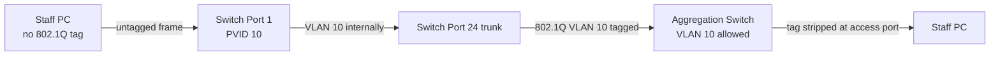

# VLAN Tag / Untag / Forbidden, PVID এবং Native VLAN (Detailed)

## VLAN মানে কী?
একই physical switch-এ logically পৃথক **Layer 2 broadcast domain** তৈরি করতে VLAN ব্যবহৃত হয়। **VLAN ID** normal range `1–4094`; `0` priority tag, `4095` reserved special value। VLAN isolation নিজে firewall নয়: router/L3 switch inter-VLAN routing enable করলে ACL না থাকলে এক VLAN থেকে আরেক VLAN reach করা সম্ভব।

## Tagged, Untagged, Forbidden কী?
| Term | Ingress interpretation | Egress behavior | Typical port |
|---|---|---|---|
| **Tagged member** | Frame includes 802.1Q VLAN ID; accepted if permitted | Frame leaves with VLAN tag | trunk/uplink |
| **Untagged member** | Untagged ingress mapped to PVID (if permitted) | Tag removed on egress | access/client port |
| **Forbidden/excluded** | Membership disallowed / dropped depending switch | Never forward that VLAN out | isolated port |

**Important:** `Forbidden` শব্দটি generic all-vendor CLI নয়। কিছু managed switch GUI-তে VLAN membership = **Tagged/Untagged/Forbidden**; অন্যটিতে `excluded` বা `not member`। Ingress acceptance এবং egress membership both check করতে হবে; hardware/vendor differences matter।



## PVID / Native VLAN
**PVID:** untagged ingress frame কোন VLAN-এ classify হবে। **Native VLAN:** some trunk implementations (Cisco default 802.1Q behavior) untagged frames carry a native VLAN; mismatch can cause leaks/security risks। Cisco trunk-এর native VLAN and allowed VLAN separate things। Some trunk setups **all VLAN tagged** করে (especially switch-to-router or provider side), তাই vendor default assume করো না।

### A basic switch VLAN membership table
| Port | Role | VLAN 10 | VLAN 20 | PVID |
|---|---|---|---|---:|
| 1 | Staff access | Untagged | Forbidden | 10 |
| 2 | Guest access | Forbidden | Untagged | 20 |
| 24 | Uplink trunk | Tagged | Tagged | unused/managed native setting |

**Frame walk:** Port 1 untagged PC frame receive → PVID 10 assigned → trunk port 24 transmit VLAN10 tag → remote switch maps VLAN10 → remote access egress strips tag।

## Real Cisco lab example
```cisco
conf t
vlan 10
 name STAFF
vlan 20
 name GUEST
interface GigabitEthernet1/0/1
 switchport mode access
 switchport access vlan 10
interface GigabitEthernet1/0/2
 switchport mode access
 switchport access vlan 20
interface GigabitEthernet1/0/24
 switchport mode trunk
 switchport trunk allowed vlan 10,20
end
show vlan brief
show interfaces trunk
```
This example is IOS/IOS XE on a VLAN-capable Catalyst-style switch; platform syntax/interface numbering varies। On trunk, VLAN 10/20 are usually tagged; inspect native VLAN. Avoid removing management VLAN from remote trunk।

## Common faults
1. **Allowed VLAN missing:** VLAN20 users at far switch lose reachability but VLAN10 works।
2. **PVID mismatch:** untagged PC lands in wrong segment।
3. **Native VLAN mismatch:** untagged traffic misclassified, may have security implications।
4. **Wrong tag handling ONU/OLT:** CPE sends untagged PPPoE but aggregation expects VLAN 200 tagged; discovery not reaching server।
5. **VLAN permitted but SVI down:** L2 works, L3 gateway unavailable।

## Viva
- **Q:** `Tagged` কি encryption? **A:** No, 802.1Q VLAN identifier।
- **Q:** Untagged port VLAN জানে কীভাবে? **A:** PVID/access VLAN configuration।
- **Q:** Forbidden meaning? **A:** That VLAN is not allowed as a member of that port।
- **Q:** VLAN tag size? **A:** Standard 802.1Q tag adds 4 bytes।
- **Q:** VLAN 10 ↔ VLAN 20 without routing? **A:** No ordinary IP cross-VLAN forwarding।

**References:** [IEEE 802.1Q](https://1.ieee802.org/802-1q/) · [MikroTik Bridge VLAN Filtering](https://manual.mikrotik.com/docs/bridging-and-switching/).
