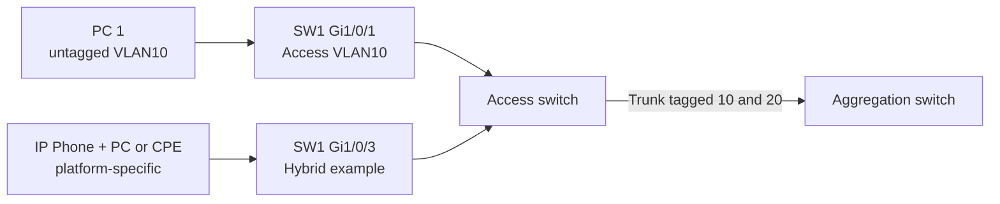

# Switch Port Access, Trunk, Hybrid: Cisco, Huawei ও ISP Example

## Port roles
**Access:** সাধারণত one untagged data VLAN (IP phone voice VLAN may coexist depending platform)। **Trunk:** multiple VLANs usually tagged, with native/untagged behavior platform-specific। **Hybrid:** one or more untagged and tagged VLAN memberships on same physical port, used on some Huawei/OLT/access switching designs। Generic Cisco Catalyst CLI-তে `switchport mode hybrid` usual নয়; Huawei VRP has `port link-type hybrid` on supported switches।



| Scenario | Port | VLAN10 | VLAN20 | Explanation |
|---|---|---|---|---|
| Employee desktop | Access | Untagged | Not allowed | One broadcast domain |
| Switch uplink | Trunk | Tagged | Tagged | Both VLANs over one cable |
| Hybrid port | Hybrid | Untagged | Tagged | Native/data traffic + tagged service |

## Cisco IOS XE Catalyst sample
```cisco
conf t
vlan 10
 name OFFICE
vlan 20
 name VOICE
interface GigabitEthernet1/0/1
 description OFFICE-ACCESS
 switchport mode access
 switchport access vlan 10
interface GigabitEthernet1/0/24
 description UPLINK-TRUNK
 switchport mode trunk
 switchport trunk allowed vlan 10,20
end
show interfaces gigabitEthernet1/0/24 switchport
show interfaces trunk
```
Use `show` before changes; topology might rely on management VLAN not included above. Trunk allowed list overwrite may cause outage।

## Huawei VRP hybrid sample (isolated lab, exact model dependent)
```text
system-view
vlan batch 10 20
interface GigabitEthernet0/0/3
 port link-type hybrid
 port hybrid pvid vlan 10
 port hybrid untagged vlan 10
 port hybrid tagged vlan 20
quit
display port vlan
```
Default VLAN1 membership/security posture vary. On Huawei some platforms require removing default untagged VLAN 1 from hybrid port; verify `display current-configuration interface ...`, platform guide and test।

## When hybrid is useful
An ISP/access-port may carry untagged management or ordinary Internet and tagged IPTV/voice service. But it expands attack/misconfiguration surface: define accepted ingress frame types, PVID and allowed VLAN membership explicitly।

## Practice task
Given Port 1 staff VLAN10, Port 2 CCTV VLAN30, Port 24 trunk VLAN10+30: make membership table, draw tag journey, find at least three causes if CCTV unreachable।

## Viva
- **Q:** Trunk port কি automatically all VLAN carry করে? **A:** It depends on allowed list/native settings; verify।
- **Q:** Hybrid Cisco-তে same CLI? **A:** Not generic; platform-dependent।
- **Q:** Can one port tagged and untagged different VLANs? **A:** Yes, hybrid-capable design।
- **Q:** PVID applied to which ingress? **A:** Untagged (and certain priority-tagged) ingress frames।
- **Q:** A loop created by two trunks? **A:** STP or controlled LAG topology needed; wrong design causes loop।

**References:** [Huawei VRP vendor-specific syntax must be confirmed](https://support.huawei.com/enterprise/en/) · [Cisco VLAN trunks](https://www.cisco.com/c/en/us/td/docs/switches/lan/c9000/lyr2-fwd/vlan/vlan-configuration-guide/configure-vlan-trunks.html).
