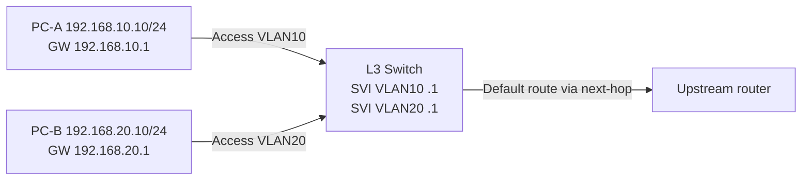

# Layer-2 vs Layer-3 Switch + Inter-VLAN Routing Lab

## Concept
L2 switch learns MAC addresses, forwards frames inside VLANs. L3 switch can route between interfaces/subnets using an IP routing table, typically via **SVI (Switch Virtual Interface)**. Pure L2 switch management SVI does not automatically route user VLAN traffic। **SVI up/up** state often requires VLAN existence and active eligible L2 port, platform dependent।



## Cisco Catalyst L3-capable switch lab (platform supports `ip routing`)
```cisco
conf t
ip routing
vlan 10
 name STAFF
vlan 20
 name GUEST
interface vlan 10
 ip address 192.168.10.1 255.255.255.0
 no shutdown
interface vlan 20
 ip address 192.168.20.1 255.255.255.0
 no shutdown
interface GigabitEthernet1/0/1
 switchport mode access
 switchport access vlan 10
interface GigabitEthernet1/0/2
 switchport mode access
 switchport access vlan 20
end
show ip interface brief
show ip route connected
show vlan brief
```
**Behavior:** inter-VLAN permitted by default on many L3 switch platforms, so real guest isolation requires **ACL or firewall**; do not treat VLAN alone as security. Not all Catalyst models/feature licenses have `ip routing` capability।

## Option B: Router-on-a-stick
Switch trunk VLAN10+20 → router subinterfaces `.10/.20` with `encapsulation dot1Q` and per-subnet IP. This consumes one router physical connection but can become throughput bottleneck compared to hardware L3 switching।

## Verify
1. PC A `ping 192.168.10.1`; PC B `ping 192.168.20.1`.
2. `show ip route` contains both connected networks.
3. `ping` PC-A→PC-B after ensuring endpoint host firewall allows ICMP.
4. If only gateway ping works: check SVI state, routes, ACL, host firewall and IP mask.
5. For Internet need upstream route, default route and return reachability, plus NAT if applicable.

## Viva
- **Q:** SVI stands for? **A:** Switch Virtual Interface।
- **Q:** Can L2 switch route two VLANs? **A:** Not without L3 routing capability/device।
- **Q:** Why `ip routing`? **A:** Enable L3 forwarding on supported Cisco L3 switches।
- **Q:** Will inter-VLAN routing automatically filter guest traffic? **A:** No।
- **Q:** Router-on-a-stick limitation? **A:** Single trunk bandwidth and router CPU/throughput constraints।

**Related:** [VLAN tags](03-vlan-tag-untag-forbidden.md) · [Cisco dedicated config](../09-vendor-configs/08-cisco-vlan-l3-switch.md).
