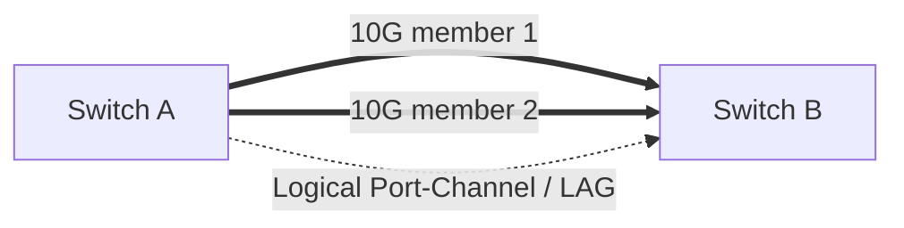

# Switching Checklist: STP, LACP, Port Security, BPDU, LLDP

## STP in plain Bangla
Two redundant L2 cable paths without a loop prevention design can create broadcast storms and MAC flapping. **STP/RSTP** select a loop-free active forwarding tree; alternate port can be blocked/discarding। **PortFast/edge port** only towards known endpoint: unmanaged switch/other bridge behind edge can be risky. Some networks use MLAG/vPC, EVPN for redundancy; those are advanced topics।

## LACP
**Link Aggregation Control Protocol (802.1AX)** combines compatible member links as logical aggregate. LACP **does not** mean single TCP flow automatically uses sum of every member; per-flow hashing commonly distributes traffic. Physical speed, duplex, VLAN, MTU and LACP actor/system parameters need to align। `active-active`, `active-passive` common; `passive-passive` does not initiate negotiation।



## Operational checklist
| Check | What to inspect |
|---|---|
| LACP not up | `active/passive`, bundle ID, neighbor, speed/duplex, VLAN/MTU, logs |
| MAC flap | L2 loop, duplicate MAC, redundant non-LAG paths, EVPN context |
| STP block | Root selection, topology changes, edge configuration |
| LLDP | Port-to-port physical peer inventory; do not assume routed adjacency |
| Port security | Max MAC, sticky behavior, violation action, authorized endpoint |
| Storm control | Protect from extreme broadcast/multicast but tune carefully |
| VLAN security | Allowed list, avoid unexpected native VLAN, disabled unused ports |

## Cisco read-only commands
```cisco
show spanning-tree summary
show spanning-tree vlan 10
show etherchannel summary
show lacp neighbor
show interfaces counters errors
show lldp neighbors detail
show mac address-table dynamic
```

## Viva
- **Q:** Why STP? **A:** Avoid L2 forwarding loops।
- **Q:** LACP two 10G = one 20G single TCP connection? **A:** Not generally; hash per flow।
- **Q:** Two passive LACP members form bundle? **A:** Usually not।
- **Q:** LLDP purpose? **A:** Neighbor discovery and inventory।
- **Q:** STP blocked port always faulty? **A:** No, it may be the expected backup path।

**References:** [IEEE 802.1AX](https://1.ieee802.org/802-1ax/) · [Cisco technology documentation](https://www.cisco.com/).
