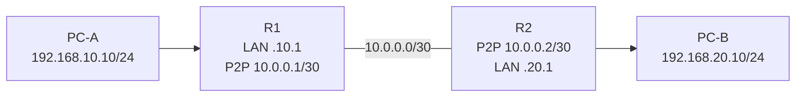

# Routing Basics, Default Gateway & Static Route

## 1. Router কী সিদ্ধান্ত নেয়?
Destination IP দেখে forwarding table থেকে **longest prefix match** select করে; equal prefix preference/metric/ECMP next-hop selection influence করে। Connected, static ও dynamic routes এক routing table-এ coexist করতে পারে।

Example:
```text
192.168.10.0/24 via connected LAN
192.168.20.0/24 via 10.0.0.2
0.0.0.0/0       via 10.0.0.1
```
`192.168.20.25` → `/24` route wins over default। `8.8.8.8` → default (if no more specific route)।

## 2. Default Gateway vs Default Route
- **Host default gateway:** Local device where off-subnet traffic is sent।
- **Router default route:** `0.0.0.0/0` routing entry, fallback for otherwise unmatched destinations।

## 3. Static Routing
Static route manually configured destination prefix + next hop/outgoing interface। Small stable network, single-homed branch, lab route বোঝার জন্য ভালো। Limitation: remote failure হলে manual change/track mechanism ছাড়া automatic alternate path নাও থাকতে পারে।

### 2-router lab topology


R1 route `192.168.20.0/24` via `10.0.0.2`। R2 route `192.168.10.0/24` via `10.0.0.1`। Return route না থাকলে **one-way routing/return path problem** হতে পারে।

## 4. Route verification steps
1. Interface addressing and link state both ends।
2. Can each router ping P2P neighbor?
3. Is remote prefix present in routing table?
4. Can router ping remote endpoint **with correct source**?
5. Destination default gateway/firewall and return path check।
6. Traceroute/packet capture দিয়ে where traffic stops track।

## 5. Static IP vs Static Route vs DHCP
- Static IP: Device address manually set।
- DHCP IP: Address dynamically assigned।
- Static Route: Router forwarding entry manually set।
- OSPF route: Routing protocol learns destination।

**Exercise:** 3 router R1—R2—R3, 3 LANs। R1 থেকে R3 LAN reach করতে minimum static routes both directions design করো।
