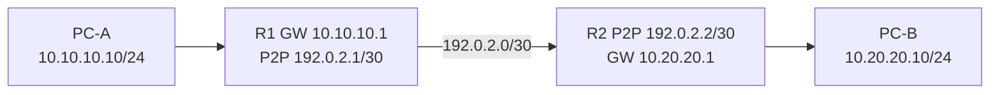

# Routing Decision: Connected, Static, Default, Longest Prefix, Return Path

## Routing vs switching
Router destination **IP** দেখে routing table থেকে best applicable route নির্বাচন করে; then next-hop L2 resolution/adjacency ব্যবহার করে forward করে। `ip route` does not “create Internet”; upstream service, NAT (if private source), firewall, and return route all matter।

## Longest Prefix Match (LPM)
When same destination matches multiple prefixes, most specific prefix wins. Example:

| Route in table | Next-hop | For destination 10.20.30.55 |
|---|---|---|
| `0.0.0.0/0` | WAN | match but least specific |
| `10.0.0.0/8` | R-A | match |
| `10.20.0.0/16` | R-B | match |
| `10.20.30.0/24` | R-C | **winner** (most specific) |

**Administrative distance/route preference** matters when choosing among different protocol routes to the *same* prefix; **metric** within a routing protocol; actual platform may use additional rules/ECMP/VRF/policy-based routing। Prefix length should not be confused with AD/metric।

## Static routing two-router configuration sketch
- R1: connected 10.10.10.0/24 and 192.0.2.0/30. `ip route 10.20.20.0 255.255.255.0 192.0.2.2`.
- R2: connected 10.20.20.0/24 and 192.0.2.0/30. `ip route 10.10.10.0 255.255.255.0 192.0.2.1`.
- Both PCs default gateway their local router. **Return route** missing হলে one-direction traffic path can fail even if outgoing route exists।

## Default route
`0.0.0.0/0` fallback IPv4 route. Use only when next-hop reachable/neighbor proper; in enterprise network upstream ISP gateway usually provides default route। A router with two WANs may need route distance/health-check or policy routing, not just two identical default routes blindly।

## Real-world diagnostics
`show ip route`, `show ip cef <dst>` (platform), `traceroute`, route lookup in RouterOS `/ip route print detail` and `/routing/route/print detail`; route presence does not prove next-hop alive. Test source-specific ping and reverse route. VLAN/subnet issues precede route table troubleshooting।

## Viva
- **Q:** Specific /24 vs /0 winner? **A:** /24 if both match।
- **Q:** Static route next hop? **A:** Reachable neighbor/recursive resolution per platform।
- **Q:** Return route why? **A:** Replies must find path back।
- **Q:** Two subnet hosts need router? **A:** Usually L3 forwarding device।
- **Q:** AD vs metric? **A:** Route-source preference vs path selection within protocol (simplified)।

**References:** [Cisco Static Routing](https://www.cisco.com/c/en/us/td/docs/routers/ios-xe/ip-routing/b-ip-routing/m_iri-ip-prot-indep-0.html) · [RFC 4632](https://www.rfc-editor.org/info/rfc4632/).
