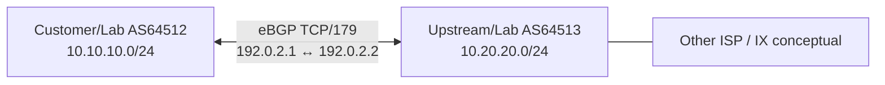

# BGP Initial Concept: ASN, eBGP/iBGP, Prefix, Peering, Filters

## Why BGP?
**Border Gateway Protocol version 4 (BGP-4)** enables exchanging network reachability between **Autonomous Systems (AS)** and (also) within an AS. ISP upstream, peering, IX and multi-homing commonly use BGP. BGP is a **path-vector routing protocol** and **policy-driven**; it is not merely “fastest ping path” selection। BGP session uses TCP/179, typically `Established` state required before route exchange।

| Term | সহজ ব্যাখ্যা |
|---|---|
| ASN | Autonomous System Number, e.g. private lab AS64512 |
| eBGP | Different AS peers |
| iBGP | Same AS peer; own route reflectors/full-mesh rules |
| Peer / Neighbor | Other router's BGP address |
| Prefix | Network being advertised, e.g. `10.10.10.0/24` (lab only) |
| AS_PATH | AS sequence used in routing and loop prevention |
| NEXT_HOP | Next-hop address of BGP route |
| Local Preference | Inside-AS policy preference, higher normally preferred |
| MED | Optional route attribute, lower often preferred when comparable |
| Prefix-list | Which networks may be accepted/advertised |
| RPKI ROA | Route origin validation, advanced security practice |



## Safe two-router lab (Cisco IOS style)
**Only isolated simulator.** 192.0.2.0/30 is example P2P, both loopbacks routes are RFC1918. Avoid announcing these to real Internet। Interface setup is a separate step:
- R1 AS64512 Gi0/0 `192.0.2.1/30`; Loopback0 `10.10.10.1/24`.
- R2 AS64513 Gi0/0 `192.0.2.2/30`; Loopback0 `10.20.20.1/24`.

**R1 BGP (announce own exact prefix only; accept only lab partner prefix):**
```cisco
configure terminal
ip prefix-list R1-OUT seq 10 permit 10.10.10.0/24
ip prefix-list R1-IN seq 10 permit 10.20.20.0/24
router bgp 64512
 bgp log-neighbor-changes
 neighbor 192.0.2.2 remote-as 64513
 neighbor 192.0.2.2 prefix-list R1-IN in
 neighbor 192.0.2.2 prefix-list R1-OUT out
 network 10.10.10.0 mask 255.255.255.0
end
```
**R2 BGP (reciprocal):**
```cisco
configure terminal
ip prefix-list R2-OUT seq 10 permit 10.20.20.0/24
ip prefix-list R2-IN seq 10 permit 10.10.10.0/24
router bgp 64513
 bgp log-neighbor-changes
 neighbor 192.0.2.1 remote-as 64512
 neighbor 192.0.2.1 prefix-list R2-IN in
 neighbor 192.0.2.1 prefix-list R2-OUT out
 network 10.20.20.0 mask 255.255.255.0
end
```
**Requirement:** exact `10.10.10.0/24` and `10.20.20.0/24` must exist in respective local routing tables; Loopback interface with `/24` supplies connected route. IOS versions address-family support and BGP feature licensing may differ। Lab lacks production-grade route policies and security; not for upstream deployment।

## Verify and troubleshoot
```cisco
show ip bgp summary
show ip bgp
show ip route bgp
show ip bgp neighbors
```
If stuck `Idle/Active`: IP ping peer, route to peer, remote AS, TCP/179 ACL, TTL/eBGP multihop topology। If Established but 0 prefixes: `network` exact RIB route, inbound/outbound filters, address-family activation, max-prefix, next-hop and policy। Never solve by `permit any` production export/inbound।

## Advanced terms, beginner-safe
- **Full routes vs default route:** full Internet tables require hardware capacity, memory, policy planning; new engineer starts with default-only in lab concept।
- **Asymmetric traffic:** outbound/inbound may follow different links. Local-pref influences outbound within AS; prepending/MED/communities have limitations and peer policy dependence।
- **BGP risk:** accidental export/route leak can affect Internet; peer authentication, max-prefix, explicit import/export filters, RPKI, monitoring and change approvals matter।

## Viva
- **Q:** BGP port? **A:** TCP/179।
- **Q:** eBGP vs iBGP? **A:** Different AS vs same AS।
- **Q:** BGP advertise a subnet without RIB route? **A:** Standard IOS `network` exact route needs to exist।
- **Q:** Local Pref winner direction? **A:** Higher usually preferred within same AS (selection step conditions apply)।
- **Q:** Why prefix filters? **A:** Prevent accidental accepting or advertising unauthorized routes।

**References:** [RFC 4271](https://www.rfc-editor.org/info/rfc4271/) · [MANRS](https://www.manrs.org/) · [Cisco BGP configuration references](https://www.cisco.com/).
