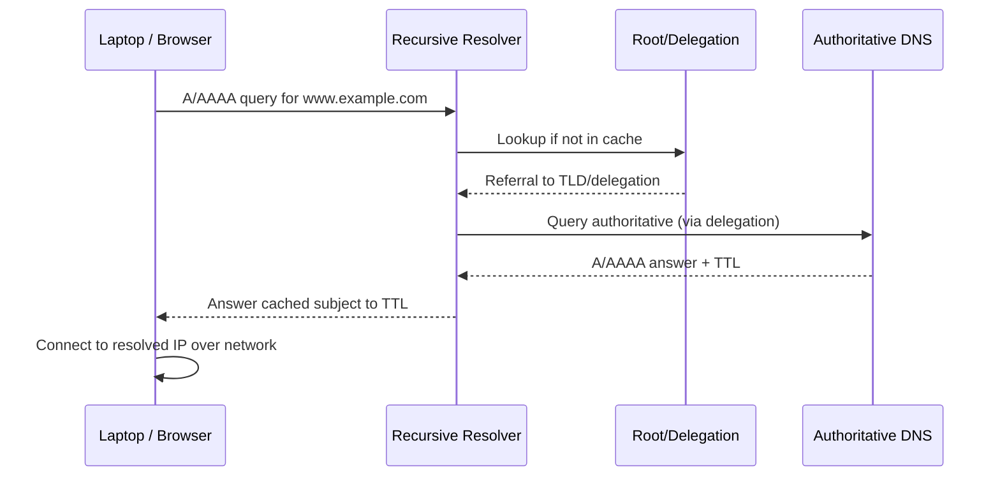

# DNS: Name Resolution, Record Types, Recursive/Authoritative, Troubleshooting

## DNS কী?
**Domain Name System (DNS)** maps human-readable domain names to records (IP and other data). Browser `www.example.com` দিলে resolver DNS query করে; server/IP থেকে website content আসে। **DNS name resolve করে, gateway/routes তৈরি করে না**। DNS protocol সাধারণত UDP/53, large/resilience cases TCP/53, DNS-over-TLS TCP/853, DNS-over-HTTPS TCP/443 etc depending client configuration।

## Flow


Actual recursive lookup includes TLD nameservers and caching; diagram is simplified।

## Record cheat sheet
| Record | Purpose | Example |
|---|---|---|
| A | IPv4 address | `web.example.test A 192.0.2.10` |
| AAAA | IPv6 address | `web.example.test AAAA 2001:db8::10` |
| CNAME | Alias to hostname | `www.example.test CNAME web.example.test` |
| MX | Mail exchanger priority | `example.test MX 10 mail.example.test` |
| NS | Authoritative nameservers | `example.test NS ns1.example.test` |
| TXT | Text including SPF verification | SPF/ownership (DKIM, DMARC special labels) |
| PTR | Reverse DNS | IP → name; under `in-addr.arpa` / `ip6.arpa` |
| SOA | Zone administrative data | Serial, timers |
| SRV | Service discovery | `service proto port target` |

`example.test` is example/private test namespace here, not publicly resolvable by default। TTL caching explains why a change may not be immediately visible. Negative answers can also be cached।

## DNS vs DHCP vs NAT
DHCP supplies client DNS resolver IP; DNS maps name to record; NAT translates addresses/ports; gateway routes off-LAN traffic. All four separate roles।

## Commands
```bash
# Linux/macOS, depending tools installed:
dig example.com A
dig example.com AAAA
dig @1.1.1.1 example.com A
dig +trace example.com
getent hosts example.com
# Look at system-configured resolver:
resolvectl status
```
```powershell
# Windows PowerShell
nslookup example.com
Resolve-DnsName example.com -Type A
ipconfig /all
ipconfig /flushdns
```
**If a public DNS resolver is unreachable** due to policy/offline lab, query local DNS instead; don't assume every corporate network permits external UDP/53।

## Common DNS failure diagnosis
1. IP `1.1.1.1` reachable, `example.com` fails? Resolver/reachability/ACL/zone/test DNS first; public ICMP may be filtered.
2. Only one domain fails? Query `A/AAAA`, CNAME chain, authoritative NS, zone TTL, DNSSEC errors.
3. NXDOMAIN? Name not found in queried DNS context (check split DNS/internal record vs public).
4. SERVFAIL? Resolver/authoritative issues, DNSSEC validation or upstream problems.
5. DNS resolves old address? TTL, caching, stale records, client hosts file.
6. Websites fail but DNS okay? TCP/TLS/HTTP, route/NAT/MTU, service itself.

## Viva
- **Q:** DNS query default port? **A:** UDP/53 usually, TCP/53 also important।
- **Q:** A vs AAAA? **A:** IPv4 vs IPv6।
- **Q:** PTR purpose? **A:** Reverse mapping IP to hostname।
- **Q:** DNS server can be ISP router? **A:** Yes if configured DNS forwarding/recursive service।
- **Q:** `dig` answer correct but browser down means? **A:** Test transport, HTTPS/TLS and route, DNS alone not enough।

**References:** [RFC 1034](https://www.rfc-editor.org/info/rfc1034/) · [RFC 1035](https://www.rfc-editor.org/info/rfc1035/) · [IANA DNS parameters](https://www.iana.org/assignments/dns-parameters/dns-parameters.xhtml).
