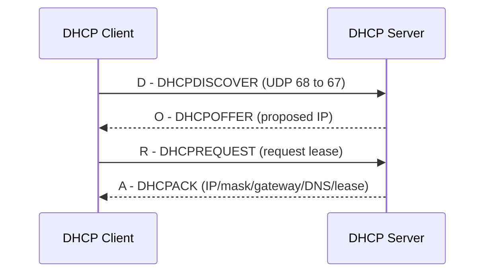
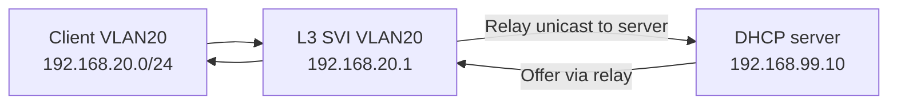

# DHCP: DORA, DHCP Client/Server/Relay, Lease, Option 3/6/82

## DHCP কী?
**Dynamic Host Configuration Protocol** automatically assigns IP configuration. Client needs IP, mask, gateway, DNS; DHCP server keeps lease database and address pool. Server হতে পারে MikroTik, Cisco router, Windows/Linux server, home-router। **DHCPv4** flow initially often uses broadcast; across routed VLANs **DHCP relay** forwards requests to remote server।



## Pool + lease example
Network `192.168.50.0/24`, gateway `192.168.50.1`, pool `.100-.199`, DNS `192.168.50.1`, lease 12h। **Exclude router .1 and static devices from pool** to avoid collisions। DHCP lease reissue can change IP if reservation absent।

| DHCP option | Meaning | Why it matters |
|---|---|---|
| 1 | Subnet mask | Correct local subnet |
| 3 | Router/default gateway | Off-subnet connectivity |
| 6 | DNS servers | Name lookup |
| 15 | Domain name | Local DNS suffix |
| 51 | Lease time | Address validity duration |
| 82 | Relay Agent Information | Access identification when relay/insertion supported; security/trust considerations |

## DHCP Relay

Cisco IOS example on supported SVI/router interface (lab):
```cisco
interface Vlan20
 ip address 192.168.20.1 255.255.255.0
 ip helper-address 192.168.99.10
 no shutdown
```
Ensure DHCP server has **scope for 192.168.20.0/24**, return route to relay and scope options. `ip helper-address` may forward additional UDP protocols depending platform defaults; review configuration/security।

## MikroTik RouterOS v7 DHCP server standalone example
```routeros
/ip address add address=192.168.50.1/24 interface=ether2
/ip pool add name=pool50 ranges=192.168.50.100-192.168.50.199
/ip dhcp-server network add address=192.168.50.0/24 gateway=192.168.50.1 dns-server=192.168.50.1
/ip dhcp-server add name=dhcp50 interface=ether2 address-pool=pool50 lease-time=12h disabled=no
/ip dns set allow-remote-requests=yes
/ip dhcp-server lease print
```
For `dns-server=192.168.50.1` MikroTik DNS forwarder must have valid upstream resolvers and trusted-only access firewall। If using bridge VLAN, DHCP server binds to **L3 VLAN interface or correct bridged LAN**, not blindly ether2 as above।

## Windows/Linux checks
Windows: `ipconfig /all`, `ipconfig /release`, `ipconfig /renew`, Event Viewer; Linux: `ip a`, `nmcli dev show`, `journalctl -u NetworkManager`, DHCP packets Wireshark filter `bootp`। On enterprise networks, do not `release` remote management interface।

## Troubleshooting
- **169.254.x.x?** No valid IPv4 DHCP lease (or manual selection), inspect VLAN path and DHCP service.
- **Wrong subnet lease?** Rogue DHCP, VLAN PVID mismatch, relay/scope error.
- **Lease exists but Internet absent?** Check gateway, route, DNS, NAT, ACL and WAN.
- **Broadcast doesn't cross router?** Configure verified relay, not broad L2 bridging.
- **Duplicate IP?** static IP within DHCP pool, stale lease, client conflicts.

## Viva
- **Q:** DORA stands for? **A:** Discover, Offer, Request, Acknowledge।
- **Q:** DHCPv4 client/server ports? **A:** UDP/68, UDP/67।
- **Q:** Option 3? **A:** Default gateway/routers।
- **Q:** DHCP relay reason? **A:** Forward DHCP across L3 boundaries।
- **Q:** DHCP offer means Internet guaranteed? **A:** No।

**References:** [RFC 2131](https://www.rfc-editor.org/info/rfc2131/) · [MikroTik DHCP manual](https://manual.mikrotik.com/docs/network-management/dhcp/server/).
