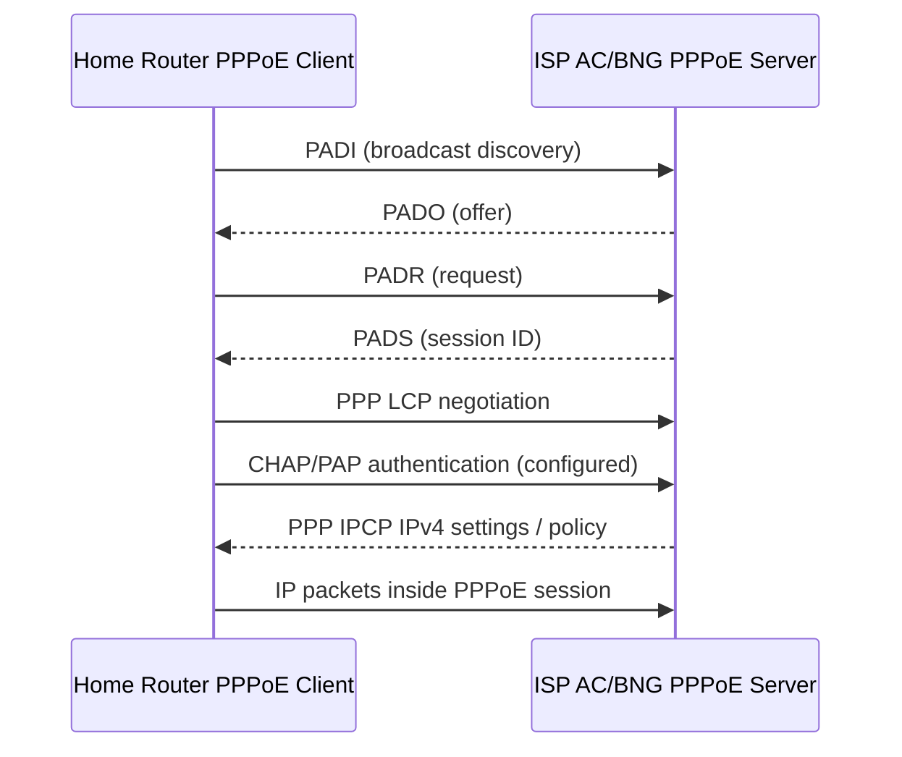

# PPPoE, Dial-up, Client, Server, PADI/PADO/PADR/PADS

## 1. PPPoE কী?
**Point-to-Point Protocol over Ethernet** is a protocol for PPP sessions over an Ethernet L2 network. Broadband ISP often authenticates subscriber with **PPPoE username/password**, assigns address from PPP profile/RADIUS, and applies policy/queue/accounting. PPPoE **client** runs on home router/CPE/MikroTik; **PPPoE server (Access Concentrator/BNG)** runs on ISP end। VLAN and ONT/OLT are transport; they are not automatically the authentication server।

## 2. Dial-up meaning: legacy vs modern
Traditional **dial-up** modem dialed a telephone number over PSTN (low-speed). Home broadband settings still say **Dial-up / PPPoE** because a software **PPP session is initiated/authenticated**, but **PPPoE over fiber/Ethernet does not dial a telephone number**। Sometimes consumer router status shows “Dialing”, “Connecting”, “Connected”; these are software session stages। A `PPPoE client` is not same as router's `DHCP client`।

## 3. PPPoE session life cycle

**Session/discovery stages:** PADI/PADO/PADR/PADS are discovery; after it PPP LCP, authentication, NCP/IPCP bring the link up. **PADT** can terminate session. Server uses subscriber credentials, profile, AAA/RADIUS rules. A wrong VLAN may mean no PADO; a wrong password may reach PADO/PADS then authentication fail।

## 4. How fiber user connects to Internet

**Bridge-mode ONU:** typically passes Ethernet PPPoE frames to home router. **Router-mode ONU:** ONU itself runs PPPoE + NAT/Wi‑Fi; downstream home router may be AP mode or may cause double NAT. **Do not run two PPPoE clients over same account** unless ISP allows sessions; `one-session-per-host` vs per-username/account policy differs।

## 5. MTU/MRU and MSS
Classic Ethernet MTU 1500 with PPPoE adds 8 bytes PPPoE/PPP overhead, so normal **PPPoE IP MTU = 1492 bytes**. Some access networks support larger baby-giant frames and RFC 4638 enhancements. Incorrect MSS/PMTUD can cause `ping works, some sites fail`, VPN stalls or partial load. ICMP too-big / fragmentation-needed filtering can break PMTUD; investigate before blindly lowering MTU।

## 6. Username troubleshooting flow
| Symptom | Where to look |
|---|---|
| No PADO | Cable/link, ONU optical, VLAN membership/trunk, server interface, AC service name |
| PADS then auth reject | username, password, RADIUS, profile, account expiry |
| PPPoE connected, no IP | IPCP/profile/address pool/RADIUS |
| PPPoE up and IP but no web | default route, DNS, NAT, forwarding, ACL, CGNAT, MTU |
| Frequent disconnect | optical fluctuation, flapping L2 port, keepalive, bad power, session policy |

## 7. Viva
- **Q:** PPPoE stands for? **A:** Point-to-Point Protocol over Ethernet।
- **Q:** PPPoE server must be on OLT? **A:** No, usually BNG/access concentrator beyond access network।
- **Q:** PADI meaning? **A:** Active Discovery Initiation।
- **Q:** PPPoE default IP MTU in 1500 Ethernet? **A:** 1492 usually।
- **Q:** Does modern fiber PPPoE dial telephone number? **A:** No।

**Hands-on:** [MikroTik PPPoE server/client config](../09-vendor-configs/07-mikrotik-pppoe-client-server.md) · [PPPoE Lab](../10-hands-on-labs/lab-13-pppoe-client-server.md).

**References:** [RFC 2516](https://www.rfc-editor.org/info/rfc2516/) · [RouterOS PPPoE Manual](https://manual.mikrotik.com/docs/virtual-private-networks/pppoe/) · [RFC 4638](https://www.rfc-editor.org/info/rfc4638/).
