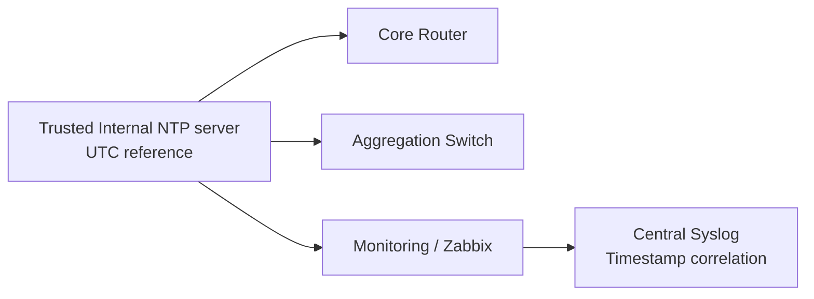

# NTP: Network Time Protocol, Dhaka Time, Logs এবং Monitoring

## NTP কী এবং কেন important?
**Network Time Protocol (NTP)** synchronizes clocks across routers, switches, servers and monitoring. NOC-এর incident correlation-এ Juniper/Cisco/MikroTik/syslog/graph-এর timestamp এক না হলে RCA কঠিন। Network device often stores UTC internally but displays configured timezone; **UTC vs Asia/Dhaka UTC+6** difference ভুল ধরো না। NTP সাধারণত **UDP/123** uses। Secure enterprise design trusted time sources, correct ACLs and auth support when available।



## MikroTik RouterOS v7 example
```routeros
/system clock set time-zone-name=Asia/Dhaka
/system ntp client set enabled=yes
/system ntp client servers add address=time.cloudflare.com
/system ntp client print detail
/system clock print
```
DNS must resolve named server and NTP UDP/123 reachable. Use an **internal approved NTP server** in production rather than a public one if company policy requires। Do not accidentally enable public-facing NTP server services।

## Cisco IOS example (verify device/release)
```cisco
conf t
clock timezone BST 6 0
ntp server 192.168.99.10 prefer
service timestamps log datetime msec localtime show-timezone
end
show ntp status
show ntp associations
show clock detail
```
`BST` in this sample is merely a locally chosen display label; use `BDT` or your organization's label as appropriate. Prefer **UTC logs on servers** with explicit timezone conversion in dashboards when operationally feasible. `192.168.99.10` must actually host NTP।

## Linux / Windows verify
Linux `timedatectl status`, `chronyc tracking`, `chronyc sources -v` (if chrony installed), `date -Is`। Windows `w32tm /query /status`, `w32tm /query /peers`। UTC system log and Dhaka UI convert correctly।

## Why NTP sync may fail
- Wrong DNS/no reachability to server.
- UDP/123 firewall, source ACL or route block.
- Wrong time source/unsynchronized upstream.
- Time zone wrong while **clock** itself actually correct.
- Huge skew, NTP stratum inconsistencies, authentication issues.

## Viva
- **Q:** NTP protocol/port? **A:** UDP/123 সাধারণত।
- **Q:** Timezone set করা আর clock synchronize same? **A:** No।
- **Q:** Time mismatch impacts? **A:** RCA, logs, auth certificates/validity and monitoring।
- **Q:** Which source is preferred? **A:** Trusted/approved synchronized source।
- **Q:** Dhaka offset? **A:** UTC+06:00 (Bangladesh present standard time)।

**References:** [RFC 5905](https://www.rfc-editor.org/info/rfc5905/) · [NTP Project](https://www.ntp.org/).
