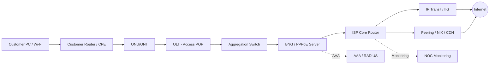

# ISP Architecture | Subscriber থেকে Internet পর্যন্ত

## ISP কীভাবে কাজ করে?
Internet Service Provider customer-এর local access network-কে regional/core/peering/transit network-এর সঙ্গে connect করে। End-to-end path-এ multiple administrative domains থাকতে পারে; একটি component ঠিক থাকলেও পুরো service healthy নাও হতে পারে।

## Components & terms
- **CPE:** Customer Premises Equipment, subscriber router/ONT।
- **OLT / ONU / ONT:** GPON access segment। ONU/ONT customer side, OLT provider side।
- **ODF:** Optical Distribution Frame, patching/cross-connect।
- **Splitter:** Passive optical splitting, link budget affects।
- **Aggregation:** Multiple access links carry towards service edge।
- **BNG/BRAS:** Subscriber session termination, authentication, IP/service policy।
- **AAA/RADIUS:** Authentication, Authorization, Accounting।
- **CGNAT:** Shared public IPv4 translation, when deployed।
- **Core:** High-capacity routing between service edges, POPs, upstreams।
- **Transit/Peering:** Upstream connectivity and exchange with other networks।

## ISP traffic categories (context-dependent)
IPT/Internet Transit, peering/NIX/IXP, CDN/cache, content platforms, private interconnect (PNI), local upstream. Same traffic names vendor/region-specific হতে পারে। Traffic graphs direction and billing unit পরিষ্কার করতে হবে।

## Fiber access path practical tracing
Subscriber account/PPPoE username → CPE WAN MAC → OLT/PON port → ONU serial/ID → splitter route → ODF → feeder fiber → aggregation uplink → BNG session → policy → route → transit।

একটি actual customer complaint-এ identifying details share না করে below evidence map create করো:

| Evidence | Why it matters |
|---|---|
| Complaint timestamp with timezone | Correlate logs/graphs |
| CPE PPPoE session state/IP | Authentication/IP assignment |
| ONU Rx/Tx and alarms | Last-mile optics |
| PON port/OLT interface status | Access health |
| Aggregation link utilization/errors | Congestion/physical issues |
| BNG session policy/queue | Speed shaping |
| Ping/traceroute/source | Layer-3 path |
| DNS/HTTP test | Application symptoms |

## Network responsibility boundary
NTTN/last-mile, ISP access, core, upstream, destination server আলাদা teams হতে পারে। Evidence ছাড়া 'upstream issue' বা 'customer router issue' declare কোরো না। Where fault starts, what is proven, what is assumed, next owner লিখবে।
