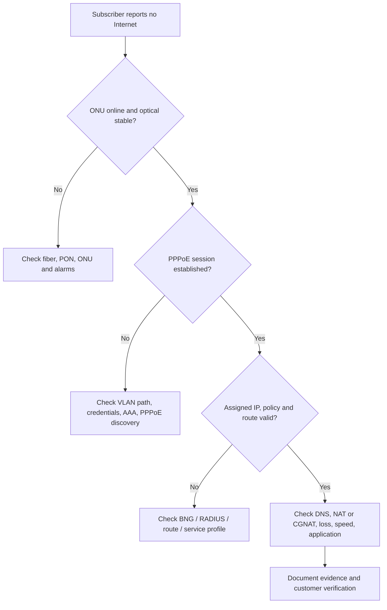

# GPON, OLT, ONU, PPPoE & Optical Troubleshooting

## 1. Optical access essentials
GPON একটি passive optical network architecture; OLT multiple ONU/ONT manage করে। Customer data mapping depends on PON port, ONU ID, GEM port/service-port, VLAN translation এবং CPE mode। Vendor অনুযায়ী CLI/API/output ভিন্ন। **কোনো model-agnostic OLT command blindly use করবে না।**

## 2. Terms
- **PON port:** OLT-এর optical access port।
- **ONU ID/SN:** ONU registration/identification; serial number sensitive হতে পারে।
- **Optical Rx/Tx dBm:** OLT and ONU receive/send power readings।
- **LOS:** Loss Of Signal, physical/optical fault hint।
- **FEC:** Forward Error Correction, counts may indicate quality under load।
- **VLAN service mapping:** Subscriber service access-to-uplink mapping।
- **Distance:** Reported ONU-to-OLT range, vendor implementation; measurement estimates vary।

## 3. Bridge mode vs routing mode
- **Bridge ONU:** Customer router PPPoE client হতে পারে, ONU mainly L2 transport।
- **Routing ONU:** ONU নিজেই PPPoE/IP/DHCP/NAT চালাতে পারে।
- Config mismatch হলে PPPoE dial fail, double NAT বা management problems হতে পারে।

## 4. Optical fault assessment
Suppose ONU Rx `-26 dBm`। এটা automatically good/bad বলা যায় না; **module class, allowed receive window, ODN split, aging/design margin, vendor specifications** check করা লাগে। Same ONU previously `-18 dBm` থাকলে sudden 8 dB degradation investigation-worthy।

Checklist: optical budget, connector cleaning approved SOP, patch cord, splitter, feeder, OLT optics, ONU temperature, intermittent LOS/flap, area-wide alarm correlation।

## 5. PPPoE troubleshooting workflow

## 6. Important NOC operational practice
`ONU Offline` vs `PPPoE Offline` difference। ONU online কিন্তু PPPoE offline হলে physical fiber okay হতে পারে, but VLAN/AAA/CPE could fail। PPPoE online কিন্তু DNS fail হলে IP connectivity আর application connectivity আলাদা test করো।

## 7. Vendor differences (intro)
BDCOM, VSOL, C-Data, Huawei, ECOM ইত্যাদিতে command and MIB differ করে। Interpreting Rx negative numbers, registration mode, service mapping, snmp `ifIndex` vendor documentation and actual OLT version match করা জরুরি।

## 8. Practice case
Customer says: "PPPoE connected, speed zero"। Evidence collect: session up-time/IP, inbound/outbound packet counters, dynamic profile/rate-limit, routing, CGNAT, upstream utilization, CPE CPU, DNS check; **avoid immediately rebooting ONU/OLT**।
