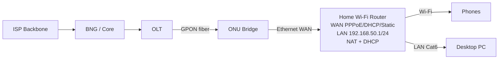

# Home Router Configure: WAN, LAN, Wi-Fi, PPPoE, DHCP, NAT

## A complete home network

## 1. WAN connection types
| WAN type | ISP gives | Router settings |
|---|---|---|
| DHCP/Dynamic IP | Just link, optional VLAN | `Automatic IP/DHCP`, obtain address/gateway/DNS |
| Static IP | IP, subnet mask/prefix, gateway, DNS, optional VLAN | Enter exactly as supplied |
| PPPoE | Username/password, optional VLAN/service | PPPoE auth; router gets session IP via PPP |
| Bridge/AP mode | No routed WAN on AP | Another gateway handles DHCP/NAT |

**WAN VLAN** may be configured at ONU, managed switch, or router WAN VLAN subinterface. Choose exactly **one coherent design**, don't tag same VLAN twice by mistake.

## 2. LAN side
Router IP `192.168.50.1/24`; DHCP pool `.100–.200`; clients gateway `192.168.50.1`, DNS router or ISP-chosen. Wi-Fi SSID `Office-Training` with **WPA2-AES/WPA3** capable devices, strong unique password; disable WPS where appropriate; firmware updates; change factory credentials। Avoid sharing production Wi-Fi passwords/PPPoE credentials on GitHub।

## 3. CPE setup in generic web UI
1. Connect laptop to **LAN** port (not WAN) via cable; browse label/gateway IP; login from approved credentials.
2. Backup current configuration and record model/firmware; if device owned by subscriber obtain authorized access.
3. `Network > WAN`: select **DHCP**, **Static**, or **PPPoE**, set any ISP-designated WAN VLAN.
4. `Network > LAN`: choose a **non-overlapping** private subnet, such as 192.168.50.0/24, router `.1`.
5. Enable LAN DHCP server pool `.100–.200` (ensure no duplicate server on LAN).
6. NAT typically enabled for router-mode private LAN→WAN IPv4; firewall enabled, WAN admin disabled.
7. `Wireless`: WPA2/WPA3, unique SSID/password, 2.4 GHz coverage vs 5 GHz throughput, interference channel planning.
8. Save/test from laptop: IP config, ping gateway, DNS, browser, speed/test to controlled endpoint; note traffic counters.

## 4. Bridge vs Router ONU and Double NAT
- **Bridge ONU** passes PPPoE frames to home router; home router dials PPPoE, NATs client IPv4.
- **Router ONU** authenticates PPPoE and NATs. If another router NATs behind it, double NAT likely; can create remote gaming/VoIP/port forwarding issues.
- **AP mode** downstream Wi-Fi router bridges client LAN to upstream CPE instead of running new DHCP/NAT; upstream controls IP leases.

## 5. Common issues
| Complaint | Verify |
|---|---|
| Wi-Fi connected no Internet | DHCP/gateway, WAN PPPoE state/IP, DNS, NAT, ONU LOS |
| Wrong PPPoE password | Server auth reject, RADIUS logs, subscriber account |
| All sites slow | Wi-Fi RSSI/channel, cable negotiated 100M, WAN utilization, packet loss |
| Only one phone no Internet | Device IP, parental controls, MAC filter, DNS private setting |
| Wi-Fi strong but Internet slow | Wi-Fi signal ≠ WAN capacity; test Ethernet cable and wired speed |
| WAN IP is 100.64/10 | ISP CGNAT possible; port forward may not work |

## Viva
- **Q:** WAN port vs LAN port? **A:** WAN faces ISP/upstream, LAN faces local clients (function can vary by mode)।
- **Q:** Router mode vs AP mode? **A:** Routing/NAT/DHCP vs bridging Wi-Fi traffic।
- **Q:** PPPoE who dials in bridge ONU design? **A:** Home router/CPE client।
- **Q:** LAN DHCP gives public IP? **A:** Usually private IP, but scope depends design।
- **Q:** Wi-Fi password and router admin password same? **A:** Separate credentials advised।

**Lab:** [Home router WAN lab](../10-hands-on-labs/lab-14-home-router-wan.md) · [MikroTik 3 WAN methods](../09-vendor-configs/10-mikrotik-home-router-wan-modes.md).
