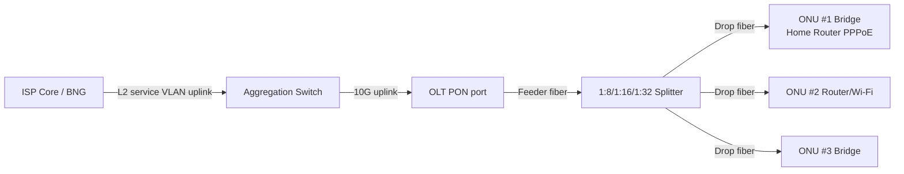

# OLT, ONU, ONT এবং GPON: Real ISP Access Network

## 1. Definitions
- **OLT (Optical Line Terminal):** ISP central-office/headend device; connects PON subscribers to aggregation network. Controls ONU registration, T-CONT/DBA/bandwidth policy and service provisioning (vendor-dependent).
- **ONU (Optical Network Unit):** optical subscriber terminal; **ONT** commonly term for customer-premise ONU. Multiple Ethernet ports, voice, Wi-Fi or bridge features may exist.
- **ODN (Optical Distribution Network):** feeder/distribution/drop fiber, passive splitter, ODF, patch cords and closures; optical budget matters.
- **PON (Passive Optical Network):** passive splitter shares the OLT optical interface across many ONUs; not a simple dedicated copper Ethernet port per ONU.

## 2. GPON data plane
GPON downstream (OLT→all ONUs on optical shared medium) and upstream (ONU→OLT timeslots) have technology-specific wavelength and TDMA/DBA. **Classical GPON nominal rates** are about **2.488 Gbps downstream and 1.244 Gbps upstream per PON port shared** before payload overhead; not a guaranteed customer speed। XG-PON/XGS-PON use other nominal rates; don't assume all ONUs support all standards। Split ratio 1:32 does not mean “exactly 1/32 speed” due to traffic scheduling, service caps and oversubscription।

## 3. From PPPoE username to optical ONU mapping
Customer PPPoE username (`customer-001`) ↔ authenticated MAC/router ↔ switch/VLAN path ↔ OLT PON port ↔ ONU serial/LOID ↔ ONU Ethernet port। Mapping requires inventory and/or vendor collection: **PPPoE session alone does not inherently reveal the ONU RX power or serial**। This is why NOC tools correlate CCR/API, OLT SNMP/CLI, VLAN and MAC forwarding tables।

## 4. Service provisioning conceptual steps
1. Authorize technician; capture backups and current OLT/PON config.
2. Confirm OLT line card/port healthy and optical budget.
3. Register authorized ONU via SN/LOID/credential depending vendor.
4. Apply profile/T-CONT/GEM mappings or vendor equivalent.
5. Define service port VLAN mapping: ONU UNI → PON/GEM → OLT uplink service VLAN.
6. Check ONU online, ONU LAN port, optical RX/TX readings, ONU distance.
7. Validate PPPoE PADI reaches AC and session comes up; document result.

**Vendor terminology warning:** BDCOM, VSOL, C-Data, Huawei, ZTE and ECOM can expose different SNMP OIDs/commands/service-port mapping. Do not copy one OLT vendor CLI to another; use [vendor-neutral template](../09-vendor-configs/11-olt-vendor-neutral-provisioning.md).

## 5. Real-world fault localization
| Symptom | Likely starting point |
|---|---|
| ONU LOS red | Fiber cut/connector/splitter or optical level outside threshold |
| ONU offline, no LOS | auth/profile/OLT port status/power (device-dependent) |
| ONU online, PPPoE no PADO | Wrong VLAN service mapping, bridge/UNI, trunk, AC/server |
| PPPoE up, no Internet | profile/IP/route/NAT/DNS/ACL |
| Many ONUs on PON disconnect | PON optics/feeder/splitter/OLT port/shared power issue |
| One ONU weak RX | drop cable, connector, splitter leg, splice/patch |

## Viva
- **Q:** OLT full form? **A:** Optical Line Terminal।
- **Q:** ONU vs ONT? **A:** ONT commonly subscriber premise ONU; naming varies।
- **Q:** Passive splitter needs power? **A:** No external active electronics usually।
- **Q:** All ONUs same optical budget? **A:** No, module class/vendor/distance/splitter matters।
- **Q:** ONU online means PPPoE authenticated? **A:** No, L1/PON status and PPPoE application/session separate।

**References:** [ITU-T G.984 GPON Recommendation](https://www.itu.int/rec/T-REC-G.984/) · [ITU-T G.9807 XGS-PON](https://www.itu.int/rec/T-REC-G.9807/) · [Existing GPON intro](02-gpon-olt-onu-pppoe.md).
