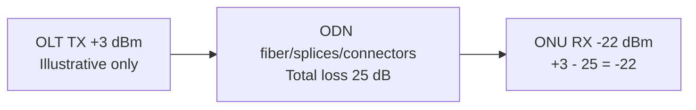

# dBm, Optical RX/TX Power, Fiber Loss, Link Budget & GPON Practical

## dBm কী?
**dBm** is optical/electrical power expressed relative to 1 milliwatt: `dBm = 10 × log10(P_mW / 1mW)`. Examples: `0 dBm = 1 mW`, `+3 dBm ≈ 2 mW`, `−3 dBm ≈ 0.5 mW`, `−10 dBm = 0.1 mW`, `−20 dBm = 0.01 mW`, `−30 dBm = 0.001 mW`। More negative receive dBm = less received optical power।

**dB** is ratio/loss; **dBm** is absolute power reference. A loss of `3 dB` roughly halves power (in linear watts); a `10 dB` loss means 10× lower power। Do not write “RX -25dB” when you mean **−25 dBm**।

## Optical link budget formula
`Predicted Rx power (dBm) = Tx power (dBm) − total path loss (dB)`. `Total path loss = fiber attenuation + splitter loss + splice losses + connector losses + engineering reserve`। Example **purely illustrative**, not a universal GPON acceptance range:

| Component | Example loss |
|---|---:|
| 8 km single-mode at ~0.35 dB/km (wavelength-dependent illustration) | 2.8 dB |
| 1:32 passive splitter | 17.0 dB (illustrative) |
| 4 connector pairs × 0.3 dB | 1.2 dB |
| 6 fusion splices × 0.1 dB | 0.6 dB |
| Engineering margin | 3.0 dB |
| **Total planning budget** | **24.6 dB** |

If TX is `+3 dBm`, computed no-margin estimated RX = `+3−(2.8+17+1.2+0.6) = −18.6 dBm`; planning reserve would leave about 3 dB further margin. **Pass/fail must follow actual transceiver class/spec and OLT/ONU thresholds**, not these example numbers. `−25 dBm` is not universally bad or good। GPON ONU RX and OLT RX readings differ and may have different spec limits।

## Rx and Tx mapping
- **ONU RX:** optical signal arriving at ONU from OLT.
- **ONU TX:** optical signal emitted from ONU upstream toward OLT.
- **OLT RX (per ONU, when supported):** received upstream optical signal from ONU.
- **OLT TX:** downstream launch power of PON transceiver.
- 10G/100G Ethernet optic DOM/DDM values may be per lane; don't interpret one number as entire composite optic।

## Warning signs
1. RX suddenly more negative, e.g. −18 → −27 dBm: increased attenuation (inspect connector, bend, patch, splitter, splice, water damage). 9 dB change is substantial.
2. RX near **overload** limit (too strong) also risky; “higher always better” false.
3. LOS/alarm intermittent: graph RX over time and note timestamps, compare affected ONUs at same splitter/PON.
4. Fiber test: clean connector properly using approved tools, never stare into fiber/optical port (laser safety). Do not unplug active subscribers casually.

## GPON vs Ethernet optics
GPON B+/C+/C++ classes and XGS-PON different budgets; SFP+ 10GBASE-LR optical power range differs again. Use actual transceiver datasheet, ODN design, wavelength and split count. Tx/Rx levels without exact **device model + class + direction** are insufficient for judgment।

## Viva
- **Q:** −20 dBm vs −25 dBm stronger? **A:** −20 dBm stronger (about 3.16× in linear power)।
- **Q:** 3 dB fiber loss means? **A:** ~half power।
- **Q:** GPON RX threshold universal? **A:** No, check specific transceiver class and OLT/ONU specs।
- **Q:** ONU RX is which direction? **A:** OLT-to-ONU downstream optical receive।
- **Q:** What information for NOC optical incident? **A:** OLT/PON/ONU identifiers, measured RX/TX dBm, timestamps, trends, LOS state, nearby subscriber comparison।

**Practice:** Compute TX `+1 dBm`, total real path loss `23 dB` → RX = `−22 dBm` (before reserve; verify against optic spec).

**References:** [ITU-T GPON Series](https://www.itu.int/rec/T-REC-G.984/) · [Fiber optics field overview](../01-foundations/03-cabling-fiber-and-hardware.md).
