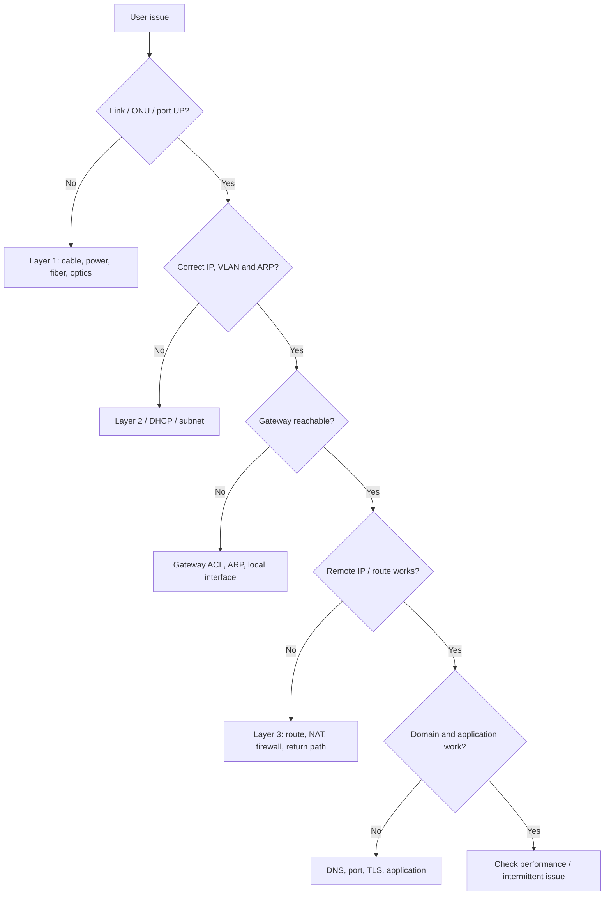

# Network Troubleshooting: Layer-by-Layer Method

## The 7-step method
1. **Define:** What exactly fails? Since when? Who is affected? One app or all?
2. **Scope:** Single host, VLAN, POP, service, upstream? Check others on same path।
3. **Collect evidence:** IP/mask/GW, MAC/ARP, link, counters, routes, DNS, loss/RTT, logs।
4. **Hypothesize:** Two plausible causes ranked by evidence।
5. **Test minimally:** Read-only verification first; change only with approval।
6. **Resolve/rollback:** Single controlled action, test expected and collateral services।
7. **Document:** Timeline, before/after evidence, root cause, prevention, owner।

## 1-minute troubleshooting flow

## Checklist: Host Internet issue
- [ ] Device/NIC power and link state
- [ ] IP/prefix/default gateway/DNS (`ipconfig /all`, `ip addr`, `ip route`)
- [ ] DHCP lease and VLAN access/trunk path
- [ ] Ping local gateway or test TCP if ICMP filtered
- [ ] Ping reachable external **approved** test IP
- [ ] DNS query independent of browser
- [ ] Service port test and TLS/browser messages
- [ ] Return path, NAT/CGNAT, host firewall, proxy policy
- [ ] Record timeline and restore confirmation

## Checklist: Fiber link
- [ ] Interface admin/oper status, optical Rx/Tx, optics thresholds
- [ ] FEC/CRC/errors/discards and link flaps
- [ ] Patch, connector polish type, last-mile physical path
- [ ] Approved end-to-end optical measurement/OTDR procedure
- [ ] Both ends interface speed/MTU/auto-negotiation

## Checklist: VLAN issue
- [ ] VLAN created on relevant switches
- [ ] Access port assigned to correct VLAN
- [ ] Allowed VLAN list and native VLAN match
- [ ] STP state and port-channel membership
- [ ] Gateway SVI/subinterface UP, ACL/route/ARP

## Checklist: BGP problem
- [ ] Peer physical and P2P reachability
- [ ] ASNs and neighbor address, loopback/update-source
- [ ] TCP/179 policy (and multihop where relevant)
- [ ] BGP state; received/accepted/installed/advertised prefixes
- [ ] Next-hop reachability and prefix filters/max-prefix/RPKI
- [ ] Changes coordinated with peer owner
