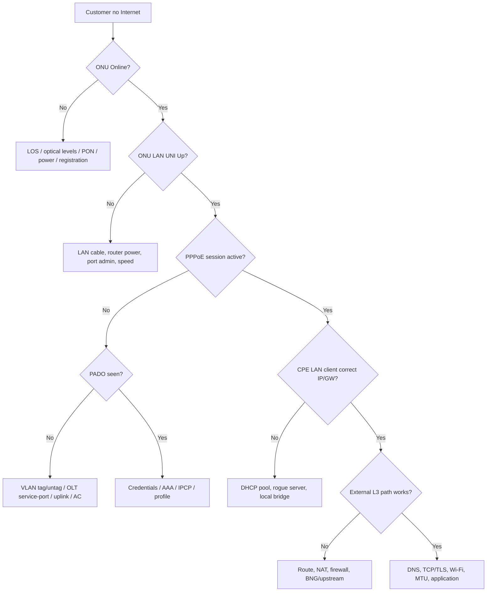

# ISP Subscriber Fault Tree: ONU→OLT→PPPoE→Router→DNS

## Treat each reported state separately
**Reported** “Internet is not working” can mean optical offline, PPP session down, incorrect lease, DNS error, Wi-Fi RF issue or application outage. Ask what works, not only what fails; use time-stamped evidence.



## Evidence collection per layer
| Layer / component | Minimum evidence | Interpretation |
|---|---|---|
| CPE Wi-Fi vs LAN | Wired vs wireless test, RSSI/channel, link speed | Is issue only Wi-Fi? |
| CPE WAN | PPPoE connected status, WAN address, default route, NAT stats | Session can be up with traffic failure |
| ONU / optical | ONU SN, PON port, LOS, RX/TX dBm, timestamps | Judge against optic specifications/trend |
| OLT / access VLAN | UNI state, VLAN mapping, uplink allowed VLAN | PADI transport may be broken |
| BNG / PPPoE | user/session state, RADIUS reason, assigned IP, ACL/queue | Discovery vs auth vs IP allocation |
| Core / upstream | RIB/FIB route, next-hop, interface errors/discards, DNS reachability | Other services affected? |

## Five realistic test cases
1. **ONU Online, PPPoE No PADO.** Check WAN cable, bridge VLAN service mapping and AC availability first; username password cannot fix missing L2 discovery path.
2. **PPPoE Authenticated, no external IP test.** Verify assigned IP/default route/NAT/firewall, BNG L3 reachability/return route, subscriber policy.
3. **External IP works, DNS fails.** Check leased DNS, resolver response type, firewall/DNS split-view and upstream.
4. **Only evening slow.** Compare access PON load, OLT uplink 10G utilization, BNG shaping, CPU, queue drops, external link peak vs Wi-Fi.
5. **One user optical Rx drops 8dB.** Compare other ONUs on same splitter and both OLT/ONU levels; physical drop-leg likely but do not confirm root cause without fiber test.

## 10-minute first response format
```text
Incident ID: _______  Time: YYYY-MM-DD HH:MM Asia/Dhaka
Affected username / POP / OLT-PON-ONU: (internal ticket only)
Impact: One customer / PON / OLT / entire region
Last-known working: _______
Physical/optical: online/LOS, ONU RX/TX dBm + historical trend
L2: UNI up/down; VLAN; MAC / PADI/PADO
PPP: active/auth/IP/RADIUS status
L3: source IP, gateway, return route, NAT, external reachability
L7: DNS, TCP/TLS/application status
Evidence collected: _______
Working hypothesis vs confirmed cause: _______
Next owner / rollback / ETA: _______
```

**Do not publish real user IDs, MAC, ONU serial, management IPs or credentials to public GitHub.**

**References:** [PPPoE deep dive](../05-services/05-pppoe-dialup-client-server.md) · [Optical dBm](../07-isp-noc/06-fiber-dbm-link-budget.md) · [Router config](../09-vendor-configs/10-mikrotik-home-router-wan-modes.md).
