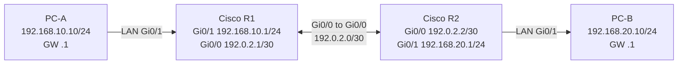

# Cisco IOS/IOS XE: Initial Static IP + Two-Router Static Routing Full Lab

**Lab-only; new isolated Cisco IOS routers/simulators.** Interface names may be `GigabitEthernet0/0`, `G0/0/0`, or different model-specific names. Use `show ip interface brief` first. NEVER paste to live router without backup/mentor approval. All example WAN/P2P IPs from documentation ranges।

## Topology


## 0. Check and document before change
```cisco
show version
show ip interface brief
show running-config
show ip route
show interfaces description
```
Get correct interfaces, existing IP, configuration mode, console connectivity. Save old config externally through approved secure process; device secrets never publish. For fresh lab set `hostname`, password/SSH hardening later in controlled exercise।

## 1. Router R1 configuration
```cisco
enable
configure terminal
hostname LAB-R1
interface GigabitEthernet0/1
 description LAN-TO-PC-A
 ip address 192.168.10.1 255.255.255.0
 no shutdown
exit
interface GigabitEthernet0/0
 description P2P-TO-R2
 ip address 192.0.2.1 255.255.255.252
 no shutdown
exit
ip route 192.168.20.0 255.255.255.0 192.0.2.2
end
show ip interface brief
show ip route
```

## 2. Router R2 configuration
```cisco
enable
configure terminal
hostname LAB-R2
interface GigabitEthernet0/1
 description LAN-TO-PC-B
 ip address 192.168.20.1 255.255.255.0
 no shutdown
exit
interface GigabitEthernet0/0
 description P2P-TO-R1
 ip address 192.0.2.2 255.255.255.252
 no shutdown
exit
ip route 192.168.10.0 255.255.255.0 192.0.2.1
end
show ip interface brief
show ip route
```

## 3. PC configurations
- PC-A manual IPv4 `192.168.10.10`, mask `255.255.255.0`, gateway `192.168.10.1`.
- PC-B manual IPv4 `192.168.20.10`, mask `255.255.255.0`, gateway `192.168.20.1`.
- DNS not needed for **IP-only ping** this lab. No actual Internet connection is provided; lab P2P `192.0.2.0/30` is reserved documentation prefix.

## 4. Expected validation
```cisco
! On R1:
ping 192.0.2.2
ping 192.168.20.1
traceroute 192.168.20.10
show ip route 192.168.20.0
show ip arp
! On R2:
ping 192.0.2.1
show ip route 192.168.10.0
```
Then from PC-A ping `192.168.20.10`; endpoint firewalls may block ICMP even with correct routing. `show ip route` shows an `S` static route and `C` connected networks where installed।

## 5. Optional default route as a SEPARATE lab
For R1 connected to a **simulated upstream gateway** `192.0.2.2` and only if R2 is configured to act as upstream:
```cisco
configure terminal
ip route 0.0.0.0 0.0.0.0 192.0.2.2
end
show ip route static
```
A default route is a fallback for unmatched destinations; its presence doesn't make documentation IPs usable on Internet. Set return routes and NAT separately as network design dictates।

## 6. If it fails, diagnose in this order
1. `administratively down`? Issue `no shutdown` on right interface.
2. `down/down`? Check cable, virtual cable mapping, peer power, optic.
3. PC ping local `.1` fails? PC mask/gateway, interface LAN, L2 VLAN, PC firewall.
4. Router can ping P2P peer but PC-to-PC fails? Check static route **both ways**, endpoint firewall, device policies.
5. Route wrong? Compare /24 destination and exact next-hop, inspect `show ip route`.
6. P2P route exists but no reply? Test source address `ping 192.168.20.1 source 192.168.10.1` (syntax support varies) and reverse path.

## 7. Save and rollback discipline
```cisco
show running-config
copy running-config startup-config
```
Save only **after tests/approval**. To remove **only** lab-created routes: `no ip route 192.168.20.0 255.255.255.0 192.0.2.2` on R1 and corresponding R2 route. Removing interface IPs resets connectivity; use console, not remote management without confirmed rollback.

## Question & Answer
- **Q:** `no shutdown` কেন? **A:** Administratively enable interface।
- **Q:** `ip address` vs `ip route`? **A:** Interface address vs route to remote prefix।
- **Q:** R1 route present but PC can't ping? **A:** Verify R2 return route + host firewall + gateways।
- **Q:** `show ip interface brief` usage? **A:** Interface address and admin/oper status।
- **Q:** PC-A to PC-B needs DNS? **A:** No for raw IP ping।

**References:** [Cisco routing docs](https://www.cisco.com/c/en/us/td/docs/routers/ios-xe/ip-routing/b-ip-routing/m_iri-ip-prot-indep-0.html) · [Related routing concepts](../04-routing/03-route-lookup-and-gateway.md).
