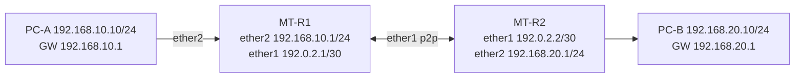

# MikroTik RouterOS v7: Initial Static IP + Two Router Routing (Full Practical)

**Lab-only:** two fresh RouterOS v7 routers after verifying default config. RouterOS factory defaults commonly include bridge, DHCP and firewall; duplicate bridge/DHCP/IP settings can conflict. Obtain console/WinBox MAC access, use **Safe Mode** and review `/export hide-sensitive` (redact) before change।

## Topology


## 0. Read-only prechecks
```routeros
/system resource print
/interface print
/ip address print
/ip route print detail
/interface bridge port print
/ip dhcp-client print detail
/ip dhcp-server print
/export hide-sensitive
```
**Do not** configure IP directly on physical `ether2` if it is already a bridge member with gateway address on `bridge`; address should live on intended L3 interface based on design. The steps below assume **empty configuration**, no default DHCP client on ether1, no bridge members ether1/ether2।

## 1. R1 settings
```routeros
/system identity set name=LAB-MT-R1
/ip address add address=192.168.10.1/24 interface=ether2 comment="LAB-LAN-R1"
/ip address add address=192.0.2.1/30 interface=ether1 comment="LAB-P2P-R1"
/ip route add dst-address=192.168.20.0/24 gateway=192.0.2.2 comment="LAB-TO-R2-LAN"
/ip address print
/ip route print detail
```

## 2. R2 settings
```routeros
/system identity set name=LAB-MT-R2
/ip address add address=192.168.20.1/24 interface=ether2 comment="LAB-LAN-R2"
/ip address add address=192.0.2.2/30 interface=ether1 comment="LAB-P2P-R2"
/ip route add dst-address=192.168.10.0/24 gateway=192.0.2.1 comment="LAB-TO-R1-LAN"
/ip address print
/ip route print detail
```

## 3. Set PC static IPs
PC-A `192.168.10.10/24`, GW `192.168.10.1`; PC-B `192.168.20.10/24`, GW `192.168.20.1`। Add PC address manually or DHCP in later optional lab; one active IP config method per interface।

## 4. Verification
```routeros
# On R1
/ping 192.0.2.2 count=5
/ping 192.168.20.1 count=5
/tool traceroute 192.168.20.10
/ip route print detail
/ip arp print
# On R2
/ping 192.0.2.1 count=5
/ip route print detail
```
PC-A → PC-B ping may be blocked by PC host firewall, test router interfaces first. RouterOS route `As`/`DAc` flags vary release; inspect installed/active status and gateway reachability, not memorized exact flag string।

## 5. Separate WAN static Internet *concept*
If using only one MikroTik router with **simulated upstream** P2P `ether1 192.0.2.2/30`, next hop `192.0.2.1`, local ether2 `192.168.10.1/24`, the one-router sample is:
```routeros
/ip address add address=192.0.2.2/30 interface=ether1 comment="LAB-WAN"
/ip address add address=192.168.10.1/24 interface=ether2 comment="LAB-LAN"
/ip route add dst-address=0.0.0.0/0 gateway=192.0.2.1 comment="LAB-DEFAULT"
/ip firewall nat add chain=srcnat src-address=192.168.10.0/24 out-interface=ether1 action=masquerade comment="LAB-SRCNAT"
```
This is **not** additive to the two-router R1/R2 config, and not Internet-ready without a real upstream. NAT alone doesn't implement input/forward firewall protection।

## 6. Common faults
- Route gateway points to own address instead of neighbor.
- WAN DHCP-client still active while static config added.
- ether2 is member of factory-default bridge but new IP assigned ether2.
- No return route on R2.
- `192.0.2.0/30` documentation P2P range not reachable on real Internet.
- NAT applied to wrong `out-interface` (if PPPoE instead of ether1).

## 7. Save + revert
```routeros
/export file=lab-reviewed-config
/system backup save name=lab-local-backup
```
Exports and backups can contain secrets: keep private/off GitHub. In **isolated lab only**, to remove a specific route tagged with comment:
```routeros
/ip route remove [find where comment="LAB-TO-R2-LAN"]
```
Do not automatically remove addresses/routes remotely unless console recovery available।

## Viva
- **Q:** RouterOS v7 static IP command? **A:** `/ip address add address=x.x.x.x/prefix interface=...`।
- **Q:** Static route command? **A:** `/ip route add dst-address=... gateway=...`।
- **Q:** CLI verify route? **A:** `/ip route print detail`।
- **Q:** Need source NAT between two private lab LANs? **A:** No, valid bidirectional routing is sufficient।
- **Q:** Why Safe Mode? **A:** Helps revert changes that disconnect management in supported scenarios।

**References:** [MikroTik First Time Configuration](https://manual.mikrotik.com/docs/getting-started/first-time-configuration/) · [RouterOS routing](https://manual.mikrotik.com/docs/routing/).
