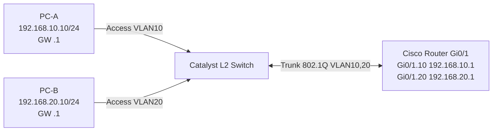

# Cisco IOS/IOS XE: VLAN Access/Trunk + Router-on-a-Stick + L3 Switch Alternatives

## Important
These are **two alternative designs**, not commands to paste all at once. Use a Cisco Catalyst switch with actual VLAN support; L3-capable models are required for `ip routing`/SVIs to route. Interface names may differ; ensure management VLAN isn't lost by narrowing trunk allowed list.

## Design A: Router-on-a-Stick


**Switch (lab):**
```cisco
conf t
vlan 10
 name STAFF
vlan 20
 name GUEST
interface GigabitEthernet1/0/1
 switchport mode access
 switchport access vlan 10
interface GigabitEthernet1/0/2
 switchport mode access
 switchport access vlan 20
interface GigabitEthernet1/0/24
 switchport mode trunk
 switchport trunk allowed vlan 10,20
end
show vlan brief
show interfaces trunk
```
**Router (lab):**
```cisco
conf t
interface GigabitEthernet0/1
 no ip address
 no shutdown
interface GigabitEthernet0/1.10
 encapsulation dot1Q 10
 ip address 192.168.10.1 255.255.255.0
interface GigabitEthernet0/1.20
 encapsulation dot1Q 20
 ip address 192.168.20.1 255.255.255.0
end
show ip interface brief
show ip route connected
```
If physical Gi0/1 was already configured with a LAN IP or NAT, redesign the IP/NAT placements instead of appending. Guest VLAN must be blocked from staff via ACL/firewall if isolation is required.

## Design B: Routing on L3 Switch (alternative)
No external router for inter-VLAN traffic, switch has SVI:
```cisco
conf t
ip routing
vlan 10
 name STAFF
vlan 20
 name GUEST
interface Vlan10
 ip address 192.168.10.1 255.255.255.0
 no shutdown
interface Vlan20
 ip address 192.168.20.1 255.255.255.0
 no shutdown
end
show ip route
show ip interface brief
```
VLAN interfaces must have active valid L2 member paths; add access ports (same as Design A) or trunk as needed. `ip routing` unavailable on some access-only devices, verify hardware license/software. Trunk not mandatory when endpoints directly connected to L3 switch access ports.

## Verification table
| Test | Expected | If not |
|---|---|---|
| `show vlan brief` | VLANs and access members | Add VLAN/membership |
| `show interfaces trunk` | VLAN10/20 allowed+active | Allowed list/native port state |
| PC→own GW | Reachable | IP/mask, access VLAN, subinterface/SVI |
| PC VLAN10→VLAN20 | Reachable **if ACL permits** | Gateway/route/ACL/host firewall |
| Inter-VLAN isolation | Block where policy says | Enforce firewall/ACL explicitly |

## Q&A
- **Q:** `encapsulation dot1Q 10`? **A:** Tag match subinterface VLAN 10।
- **Q:** SVI interface on router-on-stick required? **A:** No, routed router subinterfaces handle gateways।
- **Q:** Same VLAN PC traffic hits router? **A:** Not normally if same subnet and switching path works।
- **Q:** Access vs trunk? **A:** End host untagged vs multi-VLAN tagged link।
- **Q:** Default guest isolation with only VLAN? **A:** L2 separation only; routed traffic needs ACL/firewall।

**References:** [Cisco VLAN trunking guide](https://www.cisco.com/c/en/us/td/docs/switches/lan/c9000/lyr2-fwd/vlan/vlan-configuration-guide/configure-vlan-trunks.html) · [Concept](../03-switching/05-l2-l3-switch-intervlan.md).
