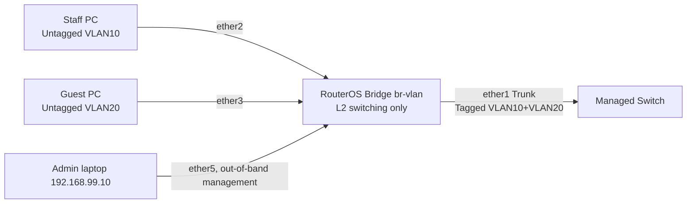

# MikroTik RouterOS v7: VLAN Filtering, Access/Trunk Lab + Safe Mode

## Topology / Safety


This config assumes **fresh isolated RouterOS v7 without defaults**, distinct `ether1/2/3/5`, and device supports VLAN bridge filtering. The design keeps **ether5 outside bridge** with management IP `192.168.99.1/24`, so enabling VLAN filter won't sever management. Do not copy to production; hardware offload support varies. Use Safe Mode when modifying bridge ports remotely. A bridged L2 VLAN alone does NOT supply DHCP/IP gateway; server on remote side must provide gateway/DHCP।

## 1. Before changes
```routeros
/interface print
/interface bridge print
/interface bridge port print
/ip address print
/export hide-sensitive
```

## 2. Independent management port and bridge
```routeros
/ip address add address=192.168.99.1/24 interface=ether5 comment="LAB-OOB-MGMT"
/interface bridge add name=br-vlan vlan-filtering=no protocol-mode=rstp
```
Connect admin laptop to ether5 (`192.168.99.10/24`); verify management access locally before proceeding।

## 3. Ports + PVID / ingress settings
```routeros
/interface bridge port
add bridge=br-vlan interface=ether1 frame-types=admit-only-vlan-tagged ingress-filtering=yes
add bridge=br-vlan interface=ether2 pvid=10 frame-types=admit-only-untagged-and-priority-tagged ingress-filtering=yes
add bridge=br-vlan interface=ether3 pvid=20 frame-types=admit-only-untagged-and-priority-tagged ingress-filtering=yes
```

## 4. Explicit egress membership
```routeros
/interface bridge vlan
add bridge=br-vlan vlan-ids=10 tagged=ether1 untagged=ether2
add bridge=br-vlan vlan-ids=20 tagged=ether1 untagged=ether3
/interface bridge vlan print detail
```
Do not write one row `vlan-ids=10,20 untagged=ether2,ether3`; it could expose VLANs to unintended ports. `br-vlan` bridge CPU **is not a tagged member of VLAN10/20** in this L2-only scenario।

## 5. Enable (last, after access/ports verified)
```routeros
/interface bridge set br-vlan vlan-filtering=yes
/interface bridge vlan print detail
/interface bridge host print
```
Check upstream switch port permits tagged VLAN10+20, has compatible native VLAN handling and attached PC gets correct subnet from **external** gateway/DHCP. If no upstream DHCP, PCs can be manually given `192.168.10.x/24` and `192.168.20.x/24`, but won't cross VLANs without L3 gateways।

## 6. RouterOS inter-VLAN gateway alternative
If instead MikroTik must route, create VLAN interfaces on `br-vlan`, make bridge CPU tagged for VLANs 10 and 20 and assign IP to VLAN interfaces; requires careful change planning. **Do not append to the L2-only config as a beginner without console/mentor**, see official manual linked below for exact CPU bridge VLAN membership and secure management design।

## Verification and problem cases
- Access port VLAN10 with wrong PVID20 → device gets wrong DHCP pool.
- Trunk VLAN20 absent → guest clients unreachable across switch.
- Lost management after enabling filter → management CPU VLAN path omitted; reason for separate ether5.
- Bridge HW offload disabled → throughput/CPU bottleneck; inspect device support.

## Viva
- **Q:** Why enable VLAN filtering at end? **A:** Avoid premature loss of L2/management path।
- **Q:** PVID role? **A:** Classify untagged ingress।
- **Q:** `tagged=ether1`? **A:** Trunk egress sends tag for that VLAN।
- **Q:** L2 bridge routes two VLANs? **A:** No, L3 gateway needed।
- **Q:** Are all MikroTik switch chips same? **A:** No, hardware offload abilities vary।

**References:** [MikroTik Bridge VLAN Filtering](https://manual.mikrotik.com/docs/bridging-and-switching/) · [VLAN theory](../03-switching/03-vlan-tag-untag-forbidden.md).
