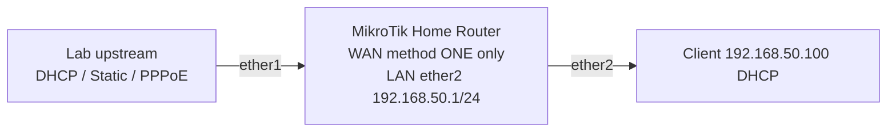

# MikroTik RouterOS v7 Home Router: WAN Static vs DHCP vs PPPoE

**Choose exactly one WAN mode** in this lab. Baseline assumes isolated router with `ether1` WAN and `ether2` separate LAN; NO existing bridge/firewall/DHCP client. Factory default config often already runs DHCP/NAT/firewall and LAN bridge; don't paste duplicates।



## 1. Select WAN mode
**Mode A: DHCP client** (when upstream offers DHCP):
```routeros
/ip dhcp-client add interface=ether1 add-default-route=yes use-peer-dns=yes disabled=no
/ip dhcp-client print detail
```
**Mode B: Static WAN** (when upstream explicitly assigns documented lab /30; this is not Internet):
```routeros
/ip address add address=192.0.2.2/30 interface=ether1
/ip route add dst-address=0.0.0.0/0 gateway=192.0.2.1
/ip dns set servers=192.0.2.1
```
Only if `192.0.2.1` actually provides DNS. Choose a valid DNS resolver per actual upstream in real deployment।

**Mode C: PPPoE** (when ISP gave credentials, and right VLAN/ether1 provides L2 discovery):
```routeros
/interface pppoe-client add name=pppoe-wan interface=ether1 user="YOUR-LAB-USERNAME" password="YOUR-LAB-PASSWORD" add-default-route=yes use-peer-dns=yes disabled=no
/interface pppoe-client print detail
```
The strings above are **placeholders** not real credentials; in production store secrets securely, don't share command history/screenshots or exports। If ISP requires a tagged WAN VLAN, create appropriate `/interface vlan add name=wan-vlan interface=ether1 vlan-id=<approved-id>` then bind PPPoE/DHCP as required, not both on bare ether1।

## 2. Common LAN for all modes
```routeros
/ip address add address=192.168.50.1/24 interface=ether2
/ip pool add name=lan50-pool ranges=192.168.50.100-192.168.50.200
/ip dhcp-server network add address=192.168.50.0/24 gateway=192.168.50.1 dns-server=192.168.50.1
/ip dhcp-server add name=lan50-dhcp interface=ether2 address-pool=lan50-pool disabled=no
/ip dns set allow-remote-requests=yes
```
Forward DNS configured resolvers or ISP peer DNS must be usable; INPUT firewall must restrict DNS service to trusted local clients. Home router must also implement an appropriate **stateful firewall**, not merely NAT; not covered as complete production rule set here।

## 3. Source NAT choose actual egress
For Mode A/B WAN L3 on `ether1`:
```routeros
/ip firewall nat add chain=srcnat src-address=192.168.50.0/24 out-interface=ether1 action=masquerade
```
For Mode C instead:
```routeros
/ip firewall nat add chain=srcnat src-address=192.168.50.0/24 out-interface=pppoe-wan action=masquerade
```
**Don't enable both** by copy-paste; NAT egress differs with PPPoE interface।

## 4. Verification and caution
```routeros
/ip address print
/ip route print detail
/ip dhcp-client print detail
/interface pppoe-client print detail
/ip dhcp-server lease print
/ip firewall nat print stats
```
- PC gets `192.168.50.100+` via DHCP and can ping `192.168.50.1`.
- WAN link running and a valid default route present.
- DNS and WAN reachability verified separately.
- If physical WAN rate 100Mbps instead of expected 1Gbps, check cable/port negotiated speed.
- If customer uses bridge ONU and PPPoE, the router should dial; if router ONU handles PPPoE, set downstream device to AP mode where applicable.

## Mini Questions
1. PPPoE interface name NAT কেন ব্যবহার করব? Because actual L3 egress is PPP tunnel interface.
2. DHCP WAN plus static WAN same interface advisable? Generally no for same service.
3. Router's LAN pool should include gateway `.1`? No.
4. Why DNS `allow-remote-requests` risky? Open resolver abuse unless firewall restricts untrusted sources.
5. Why factory config read first? Duplicate/overlapping services break clients.

**References:** [MikroTik First Time Configuration](https://manual.mikrotik.com/docs/getting-started/first-time-configuration/) · [PPPoE](https://manual.mikrotik.com/docs/virtual-private-networks/pppoe/).
