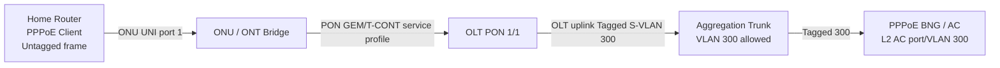

# OLT/ONU Provisioning: Vendor-Neutral Real-World SOP + VLAN Service Map

> **No invented vendor CLI:** OLT commands differ substantially across BDCOM, VSOL, C-Data, Huawei, ZTE and ECOM hardware/firmware. This chapter gives an actionable **on-device GUI/CLI checklist and example service mapping**; for exact commands use the specific model/release manual and authorized account. Replacing real CLI with guessed commands is unsafe।

## 1. End-to-end architecture


## 2. Example design table (lab identifiers only)
| Item | Value | Need to verify |
|---|---|---|
| OLT uplink | 10G GE uplink 0/1 | Link up, optic compatible, VLAN300 allowed |
| PON port | PON 1/1 | Optical TX, PON status |
| ONU SN | `DEMO-ONU-001` | Real SN/LOID not used in repo |
| ONU LAN | UNI Ethernet 1 | Bridge, link and speed |
| Customer frame | Untagged PPPoE | ONU maps into service profile |
| OLT service VLAN | 300 (tagged on uplink) | Correct service-port VLAN translation |
| BNG/AC | PPPoE service on VLAN300 | PADI/PADO path and auth profile |

## 3. Procedure (authorized lab/test subscriber)
1. Capture OLT model, firmware version, management access method and backup.
2. Observe optical module/port health: LOS, PON Tx, per ONU Rx if supported.
3. Check ONU registered (SN/LOID matches authorized customer), online state, ONU profile.
4. Confirm VLAN service mapping **per PON/ONU/UNI**, and uplink allowed VLAN. Some vendors use a `service-port` or `vlan translation` object.
5. Check ONU UNI port admin/oper status, port errors, negotiated speed, bridge/router mode.
6. Observe subscriber PPPoE attempt and BNG `PADI/PADO/PADR/PADS`, PPP auth, IP.
7. Compare expected vs actual address, VLAN, user, optical and session timestamp.
8. Update NOC inventory: OLT, PON, ONU SN, UNI, PPPoE username, customer router MAC, VLAN, RX/TX dBm.

## 4. Troubleshooting matrix
| Symptom | Layer | Check |
|---|---|---|
| ONU LOS | L1 optical | Feeder/drop fiber, connector, splitter, actual optical budget |
| ONU offline no LOS | PON control | Registration credentials/profile, power, OLT logs |
| ONU online, UNI down | Ethernet L1 | LAN cable/port/device power |
| UNI up, no PPPoE PADO | L2 | ONU bridge mode, VLAN tag/untag, service-port mapping, uplink trunk |
| PADO present, auth failed | PPP/AAA | Username/password, RADIUS response, account status |
| PPP up, no browse | L3-L7 | Address, default route, NAT, DNS, ACL, MTU |

## 5. Safe status command strategy
Because commands vary, use vendor's **read-only** sections: `display/show ONU status`, `display/show optical RX/TX`, `display/show MAC`, `display/show VLAN/service-port`, `display/show PON alarm`, `display/show interface counters` equivalents. Cross-check output fields and units. Don't scan or re-register active ONUs without authorization।

## 6. Incident evidence template
```text
Time (Asia/Dhaka): YYYY-MM-DD HH:MM
OLT model/version: __________
OLT / PON / ONU serial / UNI: __________
Service VLAN / PPPoE user: __________
ONU LOS/Online: __________
ONU RX dBm / TX dBm: __________
OLT RX per ONU (if available): __________
UNI link speed / errors: __________
PPPoE discovery/auth state: __________
RADIUS cause (if authorized): __________
Actions & customer impact: __________
Recovery / further owner: __________
```

## Viva
- **Q:** ONU online but PPPoE fails: which layer? **A:** Often L2 VLAN/bridge or auth; test in order।
- **Q:** Can one OLT CLI apply all vendors? **A:** No।
- **Q:** Meaning of service VLAN? **A:** Provider L2 service identifier mapped across access transport।
- **Q:** Can RX be judged without optic class? **A:** No।
- **Q:** Evidence key? **A:** Time, identifiers, optical/session/VLAN, exact observed states।

**References:** [ITU-T GPON](https://www.itu.int/rec/T-REC-G.984/) · [Vendor concept](../07-isp-noc/05-olt-onu-gpon-design.md).
