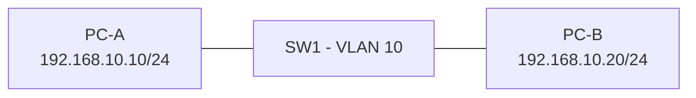

# Lab 01: Two PC Basic LAN, Ping & ARP

**Difficulty:** Beginner · **Duration:** 30–45 minutes · **Tool:** Packet Tracer / real isolated switch + two lab laptops

## Objective
Same subnet host communication, network/broadcast/gateway এবং ARP/MAC learning বুঝে করা।

## Topology

## Plan
PC-A `192.168.10.10/24`, PC-B `192.168.10.20/24`। Same-subnet ping-এর জন্য default gateway প্রয়োজন নেই। Switch দুই access port একই VLAN-এ।

## Procedure
1. Simulator-এ PC-A, PC-B, one switch deploy করে cable দাও।
2. Static IP on PC-A & PC-B; network mask `255.255.255.0`।
3. PC-A থেকে `ping 192.168.10.20`, PC-B থেকে `ping 192.168.10.10`।
4. `arp -a`/`ip neigh` দেখো। Switch `show mac address-table` (simulation support হলে)।
5. PC-B-এর address `192.168.20.20/24` করলে কী ঘটে দেখো; test শেষে restore।

## Expected observations
- Correct same subnet হলে bidirectional ping (host firewall permitting)।
- ARP neighbor MAC learned; first ping slower/initial miss হতে পারে।
- Address different subnet হলে without router/gateway direct ping fail।

## Troubleshoot challenge
PC-A ping fail কিন্তু link green: VLAN membership, mask, PC host firewall, ARP, cable port status examine করো।

**Submission:** screenshot/text of topology, IP config, 4 ping results, ARP output, explanation why gateway is not required for local traffic।
