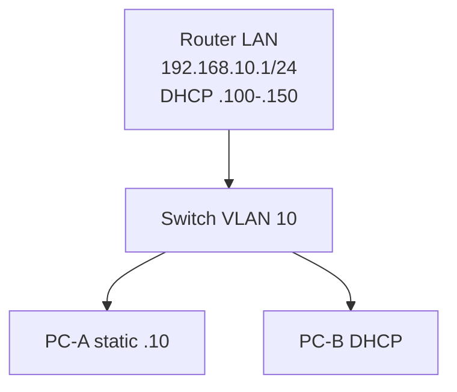

# Lab 02: Static IP vs Dynamic IP / DHCP

**Duration:** 60–75 minutes · **Tools:** MikroTik CHR or Cisco/router simulator, switch, 2–3 PCs

## Objective
একটি PC static IP পাবে, অন্য PC DHCP lease পাবে। Assignment mechanism-এর difference observe করবে।

## Topology

## Setup
1. Isolated router LAN IP `192.168.10.1/24` set করো।
2. DHCP pool `192.168.10.100–192.168.10.150`, gateway `.1`, DNS `.1` (if resolver enabled) configure করো। RouterOS instructions: [vendor guide](../09-vendor-configs/mikrotik-routeros-v7.md)।
3. PC-A static `192.168.10.10/24`, GW `.1`। PC-B DHCP auto।
4. Check PC-B received lease in pool; router `lease print` check।
5. Test ping from PC-B to router and PC-A।
6. Disable DHCP server **only in isolated lab** then renew PC-B (expected lease failure); restore।

## Compare
| Test | PC-A | PC-B |
|---|---|---|
| Assignment | Static | DHCP |
| Address | .10 | pool 100–150 |
| Subnet mask | /24 | /24 via lease |
| Gateway | .1 | .1 via lease |
| DHCP-server-down | Keeps static IP | No new/renewed lease; existing lease may persist until expiry |

## Pitfall
**DHCP off হওয়ার সঙ্গে সঙ্গে existing PC-B address disappear হয় না**; lease lifecycle matters। APIPA is OS behavior, not guaranteed immediate।

**Evidence:** DHCP DORA diagram, lease table, `ipconfig /all` or `ip addr`, explanation DHCP reservation vs manual static IP।
