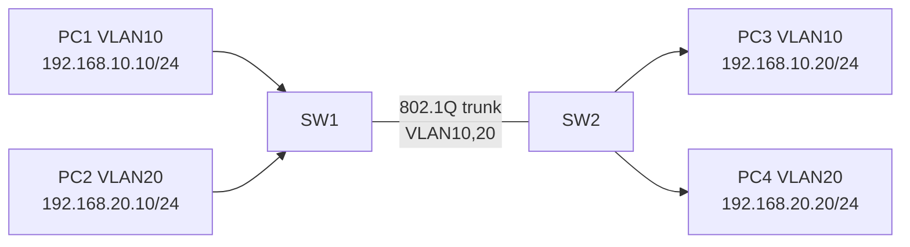

# Lab 04: VLAN 10/20 and Trunk Between Switches

**Duration:** 60–90 minutes · **Tool:** Cisco Packet Tracer

## Topology

## Instructions
1. Two switches, four PCs connect; configure VLAN 10/20 on both।
2. Ports PC1/PC3 access VLAN 10; PC2/PC4 access VLAN 20।
3. Inter-switch ports `switchport mode trunk` and allow 10,20।
4. Hosts IP as diagram; no router/gateway for this exercise।
5. `show vlan brief`, `show interfaces trunk`, `show mac address-table` verify।

## Expected ping matrix
| Source | Destination | Expected |
|---|---|---|
| PC1 | PC3 | PASS (same VLAN10) |
| PC2 | PC4 | PASS (same VLAN20) |
| PC1 | PC2 | FAIL (different VLAN, no router) |
| PC3 | PC4 | FAIL (different VLAN, no router) |

## Fault insertion
Remove VLAN20 from **one end** allowed list in isolated simulator; PC2↔PC4 fail, PC1↔PC3 still passes. Restore after documenting difference।

**Deliverable:** topology screenshot, switch config snippets, trunk and VLAN output, 4 ping results, cause of inserted fault।
