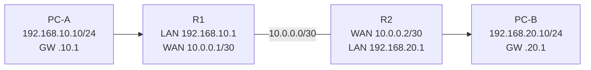

# Lab 05: Two Routers, Static Routes, Return Path

**Duration:** 75–90 minutes · **Tool:** Packet Tracer / GNS3

## Topology


## Procedure
1. Assign four router interface addresses; `no shutdown` as needed।
2. Configure PC-A and PC-B addressing with gateway।
3. Verify directly connected ping R1↔R2 first।
4. On R1 add static route `192.168.20.0/24 via 10.0.0.2`।
5. On R2 add static route `192.168.10.0/24 via 10.0.0.1`।
6. Ping PC-A→PC-B and reverse।
7. `show ip route`, `tracert` or router ping from specified source।

### Cisco snippets
```cisco
! R1, once interfaces exist
ip route 192.168.20.0 255.255.255.0 10.0.0.2
! R2
ip route 192.168.10.0 255.255.255.0 10.0.0.1
```

## Fault insertion
Remove R2 return route **in simulator only**। Observe why PC-A may send request towards B but reply cannot reach A। Restore route and document।

**Do not infer route failure from one ICMP timeout alone**; host firewall/ICMP filtering can interfere।

**Deliverable:** route tables, ping and traceroute both directions, explanation longest-prefix-match and return path।
