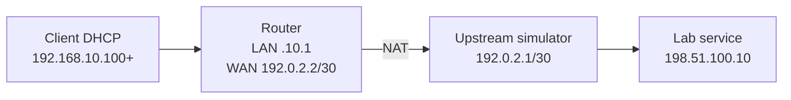

# Lab 06: DHCP Server + NAT/PAT + Upstream Simulation

**Duration:** 60–90 minutes · **Tool:** MikroTik CHR lab / network simulator

## Objective
Client dynamically receives IPv4 and accesses a simulated external test segment via NAT। **Documentation WAN addresses do not reach actual Internet**।

## Topology

## Setup
1. Create isolated WAN simulator and service destination. Ensure upstream router routes destination network and can return to NAT WAN source।
2. Router WAN static `192.0.2.2/30`, GW `192.0.2.1` (or lab DHCP simulation as alternative, not both)।
3. LAN `192.168.10.1/24`, DHCP `.100–.199`; set gateway/DNS appropriate।
4. Add masquerade/srcnat on WAN interface for source `192.168.10.0/24`।
5. Test client lease, ping router, ping remote service IP. Capture NAT translation/connection tracking if platform supports।

## Before/after experiment
In isolated lab, disable NAT rule; if upstream lacks route back to private LAN, replies fail. Re-enable NAT and compare counters. If upstream **does** have private return route, NAT may not be necessary for this lab; explain that distinction।

## Verification evidence
- Client IP/mask/GW/DNS
- DHCP lease status
- Router connected/default route
- NAT counters/active translations
- Ping/TCP to remote lab target

**Question:** Why can't NAT alone fix missing WAN route? What is PAT? Why is inbound connection not automatically allowed by outbound srcnat rule?
