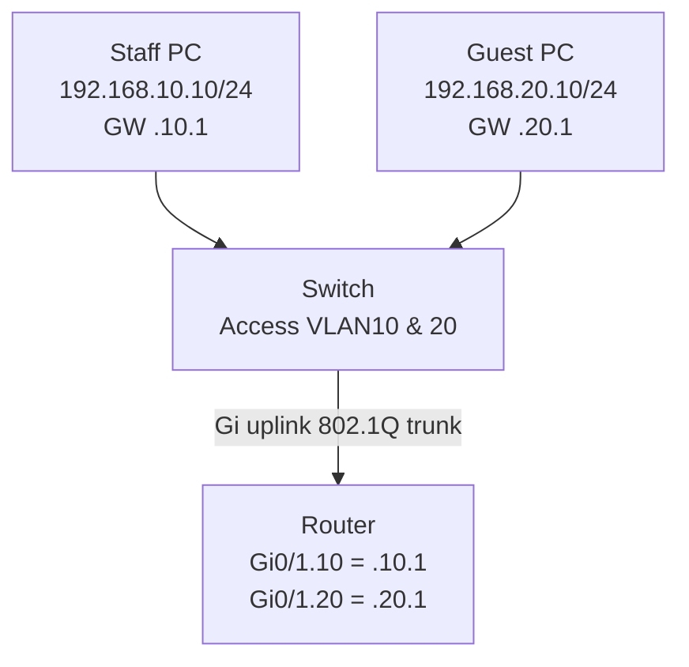

# Lab 07: Inter-VLAN Routing with Router-on-a-Stick

**Duration:** 90 minutes · **Tool:** Cisco Packet Tracer

## Topology

## Steps
1. Create VLAN10/VLAN20 switch side and place each PC on correct access port।
2. Switch uplink `trunk allowed vlan 10,20` to router Gi0/1।
3. Router physical Gi0/1 `no ip address; no shutdown`, subinterface `.10` encapsulation dot1Q 10, IP `192.168.10.1/24`; `.20` tag20, IP `192.168.20.1/24`।
4. PC default gateways as diagram।
5. Verify `show ip interface brief`, switch `show interfaces trunk` and ping PC-A→PC-B।

Use [Cisco configuration chapter](../09-vendor-configs/cisco-ios-initial.md#e-inter-vlan-routing-router-on-a-stick-alternative) for command example।

## Controlled fault
VLAN20 removed from trunk allowed list, test PC-B gateway failure. Restore. Next, add ACL (mentor supervision) to block Guest→Staff and permit DNS/Internet as exercise; don't use any production policy blindly।

**Deliverable:** Before routing ping matrix, after routing matrix, each port VLAN membership, explanation why switch L2 alone cannot route।
