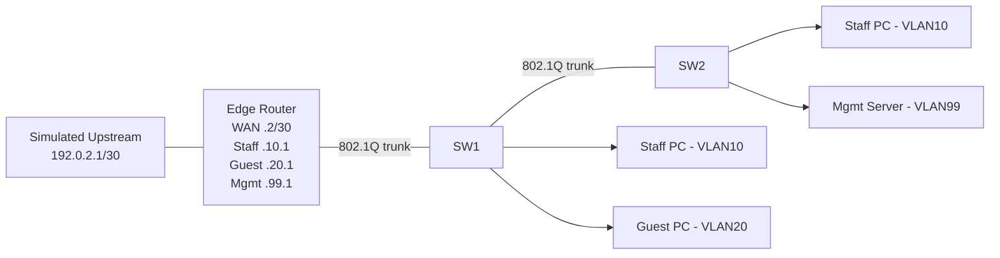

# Lab 12: Final Capstone | Mini Office + ISP Edge

**Duration:** 3–5 hours · **Tool:** Packet Tracer / GNS3 / EVE-NG

## Requirements
One WAN simulated upstream, one edge router, two managed switches, four staff/guest PCs, one server, three VLANs, DHCP, NAT, static route, troubleshooting and report. Optional OSPF comparison or simulated ONU/CPE subscriber path।

## Diagram

## Mandatory deliverables
1. **Logical & physical topology** with port labels, VLAN IDs, link speeds।
2. **IP plan** for VLAN10 `192.168.10.0/24`, VLAN20 `192.168.20.0/24`, VLAN99 `192.168.99.0/24`, WAN `192.0.2.0/30` simulator।
3. **Switch configs:** access/trunk + allowed VLANs, read-only verification।
4. **Router config:** VLAN gateways/subinterfaces, default route, NAT to lab WAN; return path।
5. **DHCP:** Staff/Guest separate pools; management server static or reservation।
6. **Policy:** Guest VLAN cannot reach Mgmt server; Staff permitted only as authorized; use lab ACL/firewall।
7. **Testing matrix:** same VLAN, inter-VLAN, WAN test, DNS (if server configured), blocked Guest-to-Mgmt test।
8. **Fault injection:** Wrong VLAN assignment OR missing return route; reproduce and recover।
9. **Incident note:** Timestamp, impact, root cause, exact corrective action, validation evidence।
10. **Safe repository:** Redacted config snippets, no passwords or user data।

## Suggested grading (100)
| Category | Marks |
|---|---:|
| Correct topology/IP allocation | 15 |
| VLAN/access/trunk | 15 |
| Routing/default route | 15 |
| DHCP + NAT | 15 |
| Guest isolation/security | 10 |
| Tests & evidence | 15 |
| Fault isolation & rollback | 10 |
| Clear communication | 5 |

## Acceptance tests
- Staff clients receive correct VLAN10 IP/GW and can reach allowed lab service।
- Guest clients receive VLAN20 IP/GW, Internet lab simulation permitted but management service blocked (verify appropriate policy). 
- Management server remains available from authorized staff/jump host।
- One trunk failure simulated in safe environment, behavior recorded.
- All configuration tested in simulator, with limitations clearly stated।

**Final viva:** Explain packet journey from Guest PC to WAN, first hop MAC, how gateway and NAT alter traffic, and what changes when destination is another VLAN।
