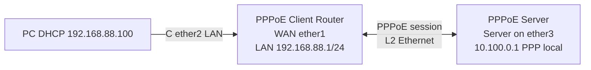

# Lab 13: Build a PPPoE Server + Client on MikroTik

**Time:** 60–90m · **Tool:** 2 RouterOS v7 CHR routers or 2 isolated physical MikroTik routers · **Prerequisite:** [PPPoE theory](../05-services/05-pppoe-dialup-client-server.md)

## Diagram

## Objectives
Explain discovery PADI→PADO→PADR→PADS; establish PPPoE session with username/password; configure client LAN DHCP; run NAT out **logical pppoe interface**; diagnose deliberate wrong password. No public Internet required।

## Lab steps
1. Build only the isolated L2 link; verify both ethernet interfaces `running`.
2. On server use exact [server example](../09-vendor-configs/07-mikrotik-pppoe-client-server.md#1-server-user-pool-ppp-profile-secret-pppoe-ac) for pool `10.100.0.2-.50`, profile, test secret.
3. On client create PPPoE client `pppoe-out1`, `add-default-route=yes`, `disabled=no`.
4. Use `/ppp active print detail` on server and `/interface pppoe-client monitor pppoe-out1 once` on client.
5. Configure LAN `192.168.88.1/24`, DHCP pool and NAT on client from same guide.
6. PC gets DHCP lease, can ping router gateway `192.168.88.1`; client router pings PPP peer `10.100.0.1`.

## Controlled fault injection
- Change client password to invalid placeholder: which authentication/PPP log changes? Restore correct training password.
- Disconnect Ethernet cable: observe physical link and PPPoE session down; reconnect.
- Change `service-name` mismatch: study no-offer / server selection behavior. Restore.

## Checklist / Marking (20)
- [ ] Cables/interfaces verified (3)
- [ ] Session active and peer IP documented (5)
- [ ] LAN lease received and gateway ping (4)
- [ ] NAT out-interface points to PPPoE logical interface (3)
- [ ] Three fault symptoms explained and restored (5)

**Submission:** topology screenshot, redacted `/ppp active`, client monitor, DHCP lease, root-cause notes. Never submit real credentials. Isolated lab doesn't imply Internet reachability।
