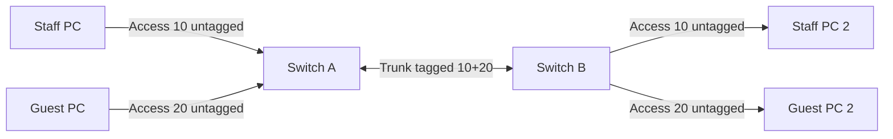

# Lab 15: VLAN Tag/Untag/Forbidden + Hybrid Port Exercise

**Time:** 60m · **Prerequisite:** [VLAN terms](../03-switching/03-vlan-tag-untag-forbidden.md), [port types](../03-switching/04-access-trunk-hybrid.md).

## Setup
- Two VLANs 10/20; correct PVID each access port.
- Inter-switch port sends **both tagged**; allowed list 10,20; verify VLAN membership.
- IP examples: staff VLAN10 `192.168.10.10` and `192.168.10.11/24`; guest VLAN20 `192.168.20.10` and `.11/24`. No L3 router: same-VLAN hosts should reach each other, cross-VLAN should not.
- Draw a **hybrid port** separately: VLAN10 untagged, VLAN20 tagged; explain ingress/egress on vendor that supports hybrid.

## Checks
Cisco `show vlan brief`, `show interfaces trunk`; MikroTik `/interface bridge vlan print detail`, `/interface bridge port print`; Huawei `display port vlan` (platform-specific). Compare pre/post MAC tables, ping and ARP entries।

## Inject mistakes
1. Remove VLAN20 from trunk allowed list; predict which hosts fail.
2. Set staff access PVID to VLAN20; explain wrong subnet.
3. Mark guest port “Forbidden” in VLAN20 membership; explain drop.

## Submission (20)
VLAN membership matrix (5), correct topology (5), test matrix (5), root-cause and fix (5). Be careful not to disconnect production management VLAN।
