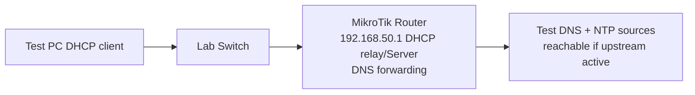

# Lab 17: DHCP + DNS + NTP End-to-End Validation

**Time:** 60m · **Network:** isolated LAN with one DHCP server and one test client.

## Objectives
- Show a full **DORA** sequence in Wireshark filtered `bootp` or controlled packet capture.
- Check DHCP option 1 mask, option 3 gateway, option 6 DNS and lease expiry.
- Resolve both `A` and `AAAA` record queries using approved resolver; demonstrate that DNS IP and gateway address are separate fields.
- Set Asia/Dhaka timezone and NTP client using [NTP guide](../05-services/06-ntp-time-synchronization.md); verify clock sync (source must be reachable).

## Practical
1. Configure DHCP pool `.100–.199`, GW/DNS `.1` as in [DHCP guide](../05-services/04-dhcp-dora-relay-options.md).
2. Client `ipconfig /all` or `nmcli dev show` note assigned IP/mask/gateway/DNS.
3. `nslookup example.com` / `dig example.com` check resolver; if offline, create local test DNS record or report `upstream unavailable` rather than inventing success.
4. Check `timedatectl` or RouterOS NTP status, list timezone and synchronization source.
5. Inject wrong DNS while keeping IP/gateway correct; demonstrate `ping gateway` success but name lookup failure.

**Marks 20:** DORA (5), DHCP options (5), DNS checks (5), NTP + incident note (5).
