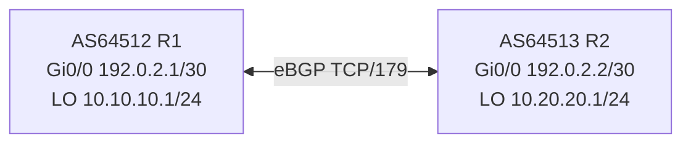

# Lab 18: BGP Peering between Two Private ASNs (Simulator Only)

**Time:** 75m · **Tools:** Packet Tracer/GNS3/EVE-NG with BGP-capable Cisco IOS image and authorized use. No production peering।

## Tasks
1. Configure IP interfaces for p2p /30 and loopback `/24` on both routers.
2. Confirm P2P ICMP before touching BGP.
3. Apply [minimal BGP lab with prefix-lists](../04-routing/04-bgp-basics-isp-lab.md) as written for each side.
4. Verify `show ip bgp summary` **Established**, `show ip bgp`, `show ip route bgp` contains opposite lab prefix.
5. Misconfigure R2 `remote-as` deliberately on isolated lab; observe neighbor state not Established, then restore.
6. Remove prefix-list permit for own announced prefix: explain session remains established but desired prefix disappears.

## Report expected
- Peer IPs and ASNs, adjacent network, original/learned prefixes, inbound/outbound prefix lists, times, screenshot/show outputs.
- Why BGP is policy-driven? Why production export filters mandatory? Why TCP/179 ACL matters?

**Marks (20):** Layer3 (4), peer (5), filtering (5), failure RCA (4), documentation (2).
