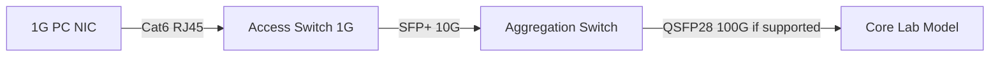

# Lab 19: Ethernet Cable, Negotiation, 1G/10G/100G and Interface Counters

**Time:** 60m · **Safety:** Use isolated test links; never disconnect production uplinks. 

## Diagram

## Checklist
1. Identify copper category (Cat5e/Cat6/Cat6A) and inspect proper T568A/T568B wiremap, patch panel label and physical damage.
2. Use an approved cable tester if available. Differentiate continuity-only cheap tester vs proper certification testing.
3. Show link `up`, speed `1000Mbps/full` on PC, and errors/discards on switch.
4. On 10G interface list transceiver type (SR/LR/BiDi etc), fiber type, wavelength, RX/TX dBm, FEC/speed where supported.
5. Explain why `10G` link with 2Gbps current utilization is 20% in that direction; link not “2G only”.
6. Optional packet test via `iperf3` **within isolated lab**, ensure traffic generator won't disrupt shared infrastructure.

## Failure inject (simulated)
- NIC limited to 100M due to wrong port/cable negotiation; log expected 100M vs intended 1G.
- Receive optical power below module specification; explain safety and correct optics/fiber diagnostics (no actual laser tampering).
- LACP member is down; record aggregate logical status, not assume total bandwidth.

**Marks 20:** media (4), speed/duplex (4), counters (4), optic/fiber checklist (4), conclusions (4).
