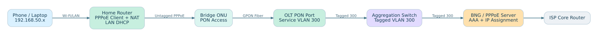
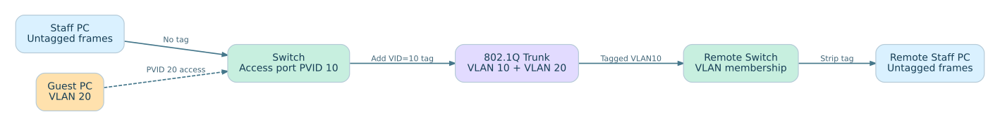
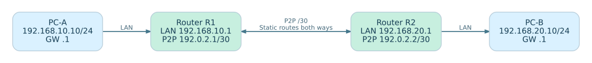
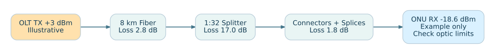

<div align="center">

# Network Engineering Intern Training Guide

### বাংলা + English | From Networking Basics to ISP/NOC Practical

**Cisco IOS/IOS XE · MikroTik RouterOS v7 · Huawei / Juniper Concepts · Realistic Network Topologies**

**20 Hands-on Labs &nbsp;|&nbsp; 220 Viva Q&A &nbsp;|&nbsp; 15 Editable Diagrams &nbsp;|&nbsp; 6-Week Extended Roadmap**

</div>

---

## Repository Overview | এই গাইডের উদ্দেশ্য

Office-based **Network Engineer Intern, NOC Trainee এবং ISP Fresher**-দের জন্য একটি GitHub-ready training repo। Each lesson explains **concept → packet path → network diagram → configuration/verification → common faults → viva Q&A**. Bangla explanations with English technical terms make teaching easier, while `.md` files remain easy to edit, link and version-control.

> [!IMPORTANT]
> সব router/switch commands **isolated lab বা simulator**-এর জন্য। Production router, switch, OLT, customer ONU বা core-এ mentor approval, current backup, impact assessment and rollback ছাড়া command apply নয়। Public repository-তে customer PPPoE credential, management IP, serial number বা export/backup file upload করবে না।

## Core Network Path: Customer to Internet



**How to learn:** [How to use](00-start-here/01-how-to-use.md) → [6-week study plan](00-start-here/04-six-week-deep-roadmap.md) → [Instructors](00-start-here/05-instructor-handbook.md) → [20 labs](10-hands-on-labs/README.md) → [Assessment](11-assessment/04-trainer-checklist.md).

## Highlights / Key Practical Tracks

| Topic | Where to start |
|---|---|
| OSI 7 Layers + packet flow | [OSI walkthrough](01-foundations/07-osi-packet-walkthrough.md) |
| TCP, UDP, ports, 1G/10G/100G, Cat6/A | [TCP vs UDP](01-foundations/04-tcp-udp-ports.md) · [Ethernet Media](01-foundations/05-ethernet-speeds-media.md) |
| Static/Dynamic IP, Private/Public, CGNAT | [Address / Gateway](02-addressing/05-static-dynamic-ip-gateway.md) · [Public/Private/CGNAT](02-addressing/07-public-private-cgnat-nat.md) |
| Subnetting + solved VLSM worksheet | [Subnetting Workbook](02-addressing/06-subnetting-workbook.md) |
| VLAN tag/untag/forbidden, access/trunk/hybrid | [VLAN Membership](03-switching/03-vlan-tag-untag-forbidden.md) · [Hybrid Ports](03-switching/04-access-trunk-hybrid.md) |
| Static routing, gateway, return route, initial BGP | [Routing Decision](04-routing/03-route-lookup-and-gateway.md) · [BGP Lab](04-routing/04-bgp-basics-isp-lab.md) |
| DNS, DHCP, PPPoE, Dial-up and NTP | [DNS](05-services/03-dns-records-troubleshoot.md) · [DHCP](05-services/04-dhcp-dora-relay-options.md) · [PPPoE](05-services/05-pppoe-dialup-client-server.md) · [NTP](05-services/06-ntp-time-synchronization.md) |
| Home Router WAN/LAN + PPPoE Client/Server | [Home Router](07-isp-noc/04-home-router-wan-lan-setup.md) · [MikroTik PPPoE CLI](09-vendor-configs/07-mikrotik-pppoe-client-server.md) |
| OLT/ONU/GPON, Uplink/Downlink, dBm | [GPON Design](07-isp-noc/05-olt-onu-gpon-design.md) · [dBm Budget](07-isp-noc/06-fiber-dbm-link-budget.md) · [Capacity](07-isp-noc/07-uplink-downlink-capacity.md) |
| Cisco & MikroTik static initial config | [Cisco Two Routers](09-vendor-configs/05-cisco-static-end-to-end.md) · [MikroTik Two Routers](09-vendor-configs/06-mikrotik-static-end-to-end.md) |
| ISP Troubleshooting | [Fault Tree](08-troubleshooting/04-subscriber-end-to-end-fault-tree.md) · [20 Labs](10-hands-on-labs/README.md) |

## Diagrams Preview

| VLAN Tagged / Untagged | Static Routing | Optical Budget |
|---|---|---|
|  |  |  |

**[Browse all 15 editable diagrams](diagrams/README.md)** · Mermaid diagrams are embedded inside the corresponding Markdown lessons.

## Complete Markdown Chapter Index

### 00 · Start Here & Instructor Tools

- [শুরু করার আগে / How to Use This Repository](00-start-here/01-how-to-use.md)
- [4-Week Intern Roadmap / ২০ দিনের Training Plan](00-start-here/02-four-week-roadmap.md)
- [GitHub-এ Repository Upload (Windows / Linux)](00-start-here/03-github-upload.md)
- [6-Week Deep Learning Roadmap / Intern → Junior NOC / ISP Support](00-start-here/04-six-week-deep-roadmap.md)
- [Instructor Handbook: How to Teach Network Interns (Bangla + English)](00-start-here/05-instructor-handbook.md)

### 01 · Fundamentals: OSI, TCP/UDP, Ethernet, L1/L2/L3

- [Networking Basics / Network কী এবং কেন?](01-foundations/01-networking-basics.md)
- [OSI, TCP/IP, Packet Journey এবং Ports](01-foundations/02-osi-tcp-ip-and-packets.md)
- [Cabling, Fiber, Optics এবং Device Hardware](01-foundations/03-cabling-fiber-and-hardware.md)
- [TCP, UDP, Port Number এবং Connection / Theory + Practical](01-foundations/04-tcp-udp-ports.md)
- [Ethernet 1G/10G/25G/40G/100G, LAN Cable ও SFP/QSFP](01-foundations/05-ethernet-speeds-media.md)
- [Layer 2 vs Layer 3, Uplink vs Downlink, LAN vs WAN](01-foundations/06-layer2-layer3-uplink-downlink.md)
- [OSI Model: Seven Layers + Real Packet Walkthrough](01-foundations/07-osi-packet-walkthrough.md)

### 02 · IPv4, IPv6, Static/Dynamic, Subnetting and NAT

- [IPv4 Address, Static vs Dynamic IP, Public vs Private](02-addressing/01-ipv4-public-private.md)
- [Subnetting, CIDR, VLSM / হাতে calculation](02-addressing/02-subnetting-cidr-vlsm.md)
- [IPv6 Basics / 128-bit Addressing](02-addressing/03-ipv6-basics.md)
- [Windows ও Linux-এ Static IP, DHCP এবং Network Testing](02-addressing/04-windows-linux-ip-setup.md)
- [Static IP, Dynamic IP, Gateway, Mask, DNS: Beginner Deep Dive](02-addressing/05-static-dynamic-ip-gateway.md)
- [IP Subnetting Workbook: CIDR, Host Calculation, VLSM + Answers](02-addressing/06-subnetting-workbook.md)
- [Public IP, Private IP, CGNAT, NAT/PAT এবং Default Route](02-addressing/07-public-private-cgnat-nat.md)

### 03 · VLAN Tags, Access/Trunk/Hybrid, STP and LACP

- [Switching: MAC Table, ARP, VLAN, Access & Trunk](03-switching/01-switch-mac-arp-vlan.md)
- [STP, RSTP, LACP, PoE & Wi-Fi Basics](03-switching/02-stp-lacp-wireless.md)
- [VLAN Tag / Untag / Forbidden, PVID এবং Native VLAN (Detailed)](03-switching/03-vlan-tag-untag-forbidden.md)
- [Switch Port Access, Trunk, Hybrid: Cisco, Huawei ও ISP Example](03-switching/04-access-trunk-hybrid.md)
- [Layer-2 vs Layer-3 Switch + Inter-VLAN Routing Lab](03-switching/05-l2-l3-switch-intervlan.md)
- [Switching Checklist: STP, LACP, Port Security, BPDU, LLDP](03-switching/06-switch-security-lacp-stp.md)

### 04 · Static, Default, OSPF and BGP

- [Routing Basics, Default Gateway & Static Route](04-routing/01-routing-static-default.md)
- [Dynamic Routing: OSPF, BGP, RIP / Beginner → ISP Intro](04-routing/02-dynamic-routing-ospf-bgp.md)
- [Routing Decision: Connected, Static, Default, Longest Prefix, Return Path](04-routing/03-route-lookup-and-gateway.md)
- [BGP Initial Concept: ASN, eBGP/iBGP, Prefix, Peering, Filters](04-routing/04-bgp-basics-isp-lab.md)

### 05 · DNS, DHCP, PPPoE, NTP and Monitoring

- [DHCP, DNS, NAT/PAT, PPPoE / Service Foundations](05-services/01-dhcp-dns-nat-pppoe.md)
- [Network Tools, Monitoring, Logs, NTP, SNMP](05-services/02-network-tools-monitoring.md)
- [DNS: Name Resolution, Record Types, Recursive/Authoritative, Troubleshooting](05-services/03-dns-records-troubleshoot.md)
- [DHCP: DORA, DHCP Client/Server/Relay, Lease, Option 3/6/82](05-services/04-dhcp-dora-relay-options.md)
- [PPPoE, Dial-up, Client, Server, PADI/PADO/PADR/PADS](05-services/05-pppoe-dialup-client-server.md)
- [NTP: Network Time Protocol, Dhaka Time, Logs এবং Monitoring](05-services/06-ntp-time-synchronization.md)

### 06 · Firewall and Security

- [Network Security Basics, Firewall, ACL & Safe Change](06-security/01-network-security-basics.md)

### 07 · ISP, Home Router, OLT/ONU and Fiber Optical

- [ISP Architecture / Subscriber থেকে Internet পর্যন্ত](07-isp-noc/01-isp-architecture.md)
- [GPON, OLT, ONU, PPPoE & Optical Troubleshooting](07-isp-noc/02-gpon-olt-onu-pppoe.md)
- [NOC Shift Runbook, Escalation, SLA & Communication](07-isp-noc/03-noc-shift-runbook.md)
- [Home Router Configure: WAN, LAN, Wi-Fi, PPPoE, DHCP, NAT](07-isp-noc/04-home-router-wan-lan-setup.md)
- [OLT, ONU, ONT এবং GPON: Real ISP Access Network](07-isp-noc/05-olt-onu-gpon-design.md)
- [dBm, Optical RX/TX Power, Fiber Loss, Link Budget & GPON Practical](07-isp-noc/06-fiber-dbm-link-budget.md)
- [Uplink & Downlink: ISP Topology, Capacity, Utilization and Bottlenecks](07-isp-noc/07-uplink-downlink-capacity.md)

### 08 · Troubleshooting and NOC Runbooks

- [Network Troubleshooting: Layer-by-Layer Method](08-troubleshooting/01-methodology-checklists.md)
- [15 Real-World NOC / Office Fault Scenarios](08-troubleshooting/02-real-world-cases.md)
- [Read-Only Command Cheat Sheet / Quick NOC Reference](08-troubleshooting/03-command-cheat-sheet.md)
- [ISP Subscriber Fault Tree: ONU→OLT→PPPoE→Router→DNS](08-troubleshooting/04-subscriber-end-to-end-fault-tree.md)

### 09 · Real Config Examples: Cisco, MikroTik, Juniper, Huawei

- [Cisco IOS/IOS XE: Initial Static IP + Two-Router Static Routing Full Lab](09-vendor-configs/05-cisco-static-end-to-end.md)
- [MikroTik RouterOS v7: Initial Static IP + Two Router Routing (Full Practical)](09-vendor-configs/06-mikrotik-static-end-to-end.md)
- [MikroTik RouterOS v7: PPPoE Server + Client + DHCP LAN + NAT](09-vendor-configs/07-mikrotik-pppoe-client-server.md)
- [Cisco IOS/IOS XE: VLAN Access/Trunk + Router-on-a-Stick + L3 Switch Alternatives](09-vendor-configs/08-cisco-vlan-l3-switch.md)
- [MikroTik RouterOS v7: VLAN Filtering, Access/Trunk Lab + Safe Mode](09-vendor-configs/09-mikrotik-vlan-bridge.md)
- [MikroTik RouterOS v7 Home Router: WAN Static vs DHCP vs PPPoE](09-vendor-configs/10-mikrotik-home-router-wan-modes.md)
- [OLT/ONU Provisioning: Vendor-Neutral Real-World SOP + VLAN Service Map](09-vendor-configs/11-olt-vendor-neutral-provisioning.md)
- [Initial Device Configuration / Vendor-specific Lab Notes](09-vendor-configs/README.md)
- [Cisco IOS / IOS XE: Initial Router & Switch Configuration (Lab)](09-vendor-configs/cisco-ios-initial.md)
- [Huawei VRP: Initial Switch/Router Configuration (Lab)](09-vendor-configs/huawei-vrp-initial.md)
- [Juniper Junos: Initial Router Commands (Lab)](09-vendor-configs/juniper-junos-initial.md)
- [MikroTik RouterOS v7: Initial Router Setup (Lab)](09-vendor-configs/mikrotik-routeros-v7.md)

### 10 · 20 Hands-on Practical Labs

- [20 Hands-on Labs / Beginner to Real ISP/NOC](10-hands-on-labs/README.md)
- [All 20 numbered practical labs](10-hands-on-labs/README.md)

### 11 · 220 Viva Questions + Practical Assessment

- [120 Network Engineer Intern Viva Questions & Answers (Bangla + English)](11-assessment/01-viva-120-questions.md)
- [Weekly Quizzes, Practical Exams & Mentor Evaluation](11-assessment/02-quizzes-and-practical-exam.md)
- [100 Detailed Network Engineering Viva Questions & Answers (Bangla + English)](11-assessment/03-detailed-viva-100-qa.md)
- [Intern Practical Skills Checklist & Scoring Sheet](11-assessment/04-trainer-checklist.md)

### 12 · Glossary, Documentation and References

- [Networking Glossary / 100+ Terms (English + বাংলা Explanation)](12-career/01-glossary.md)
- [Professional NOC Communication & Documentation](12-career/02-documentation-and-communication.md)
- [Sources & Further Learning / Official & Standards References](12-career/03-learning-resources.md)

## Lab Equipment and Validation

Recommended: Cisco Packet Tracer (per usage conditions), GNS3/EVE-NG, MikroTik CHR/isolated RouterOS devices, Wireshark, Cat6 patch cables and an optional cable tester. Use authorized **read-only** OLT and ONU screenshots if no isolated GPON lab exists. Commands may vary by model, licensing and firmware.

### Check repo integrity

```bash
python3 scripts/test_subnet_calculator.py
python3 scripts/validate_repo.py
python3 scripts/subnet_calculator.py 192.168.10.130/26
```

Expected calculation: network `192.168.10.128/26`, host range `192.168.10.129–192.168.10.190`, broadcast `.191`.

## Upload to GitHub

1. Download the ZIP and extract it.
2. Create a new GitHub repository such as `Network-Engineering-Intern-Bangla-Guide`.
3. Upload **contents inside the extracted folder**, so `README.md` appears in repository root.
4. Or follow [GitHub GUI / git CLI walkthrough](00-start-here/03-github-upload.md).
5. Keep repo public **only** if credentials, device configs, IPs and customer identities are redacted.

## Materials & Standards

Theory and examples are written for training; commands are illustrative and need verification against platform-specific manuals. Major references include **IETF RFCs, IEEE Ethernet/VLAN, ITU-T GPON, Cisco and MikroTik documentation**. See [official references and learning resources](12-career/03-learning-resources.md) (also linked at the bottom of relevant chapters).

---

<div align="center">

<sub><strong>Prepared by Amir Hosan Jesan (Netronixbd)</strong> · Network Engineering Intern Training · © 2026 · Educational use</sub>

</div>
