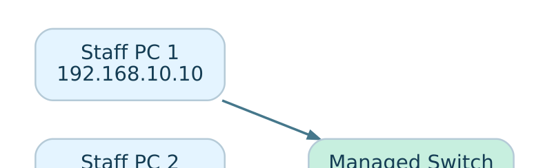
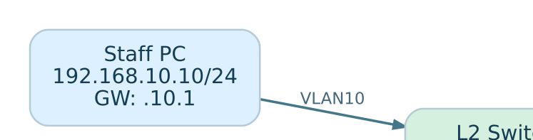
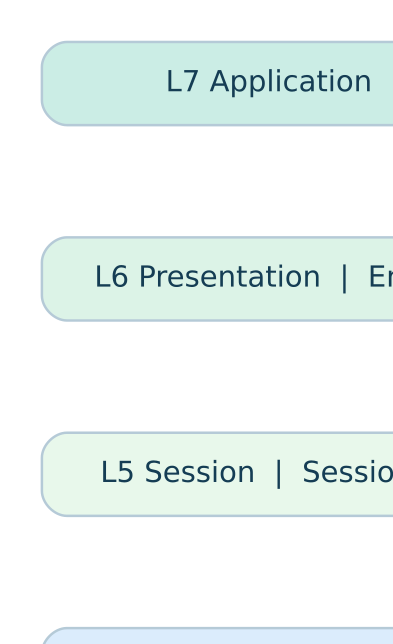
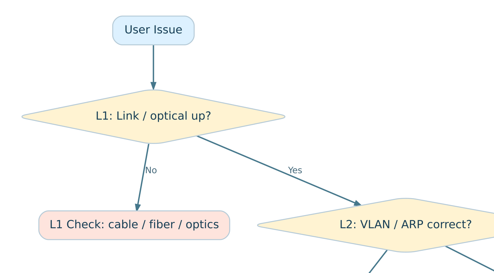
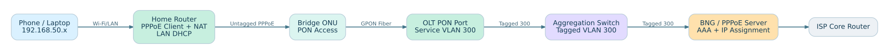
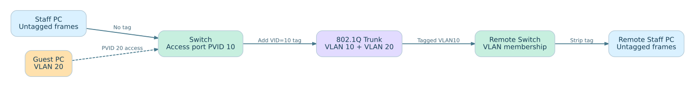
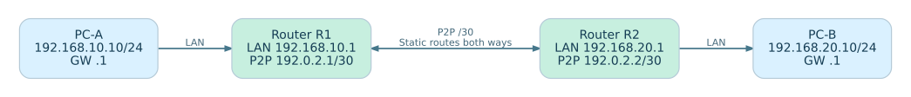
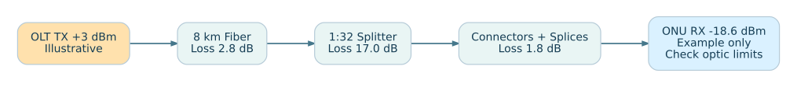
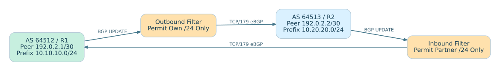
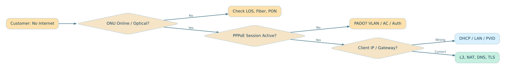

# 15 Editable Network Topology Diagrams

Each topology is available as `.dot` (Graphviz editable source), `.svg` (sharp GitHub preview) and `.png`. In addition, the Markdown concept chapters contain **inline Mermaid source diagrams**, editable by opening their `.md` files.

To regenerate from DOT: `dot -Tsvg diagrams/home-pppoe.dot -o diagrams/home-pppoe.svg`.

## Office Lan

Office LAN with access switch, local server and router.

[DOT source](office-lan.dot) · [SVG](office-lan.svg) · [PNG](office-lan.png)

## Vlan Trunk

Switch-to-switch tagged VLAN 10/20 trunk.

[DOT source](vlan-trunk.dot) · [SVG](vlan-trunk.svg) · [PNG](vlan-trunk.png)

## Intervlan Routing

Router-on-a-stick and VLAN gateway flow.

[DOT source](intervlan-routing.dot) · [SVG](intervlan-routing.svg) · [PNG](intervlan-routing.png)

## Static Routing

Two-router static routing and return path.

[DOT source](static-routing.dot) · [SVG](static-routing.svg) · [PNG](static-routing.png)

## Dhcp Dora

DHCP DORA process.

[DOT source](dhcp-dora.dot) · [SVG](dhcp-dora.svg) · [PNG](dhcp-dora.png)

## Isp Architecture

Subscriber to OLT, PPPoE BNG, core and upstream.

[DOT source](isp-architecture.dot) · [SVG](isp-architecture.svg) · [PNG](isp-architecture.png)

## Osi Model

OSI model seven-layer visual.

[DOT source](osi-model.dot) · [SVG](osi-model.svg) · [PNG](osi-model.png)

## Fault Isolation

Fault isolation decision diagram.

[DOT source](fault-isolation.dot) · [SVG](fault-isolation.svg) · [PNG](fault-isolation.png)

## Fiber Access

Fiber access from OLT to ONU and home router.

[DOT source](fiber-access.dot) · [SVG](fiber-access.svg) · [PNG](fiber-access.png)

## Home Pppoe

Real ISP PPPoE service path.

[DOT source](home-pppoe.dot) · [SVG](home-pppoe.svg) · [PNG](home-pppoe.png)

## Vlan Tagged Untagged

Tagged / Untagged VLAN membership path.

[DOT source](vlan-tagged-untagged.dot) · [SVG](vlan-tagged-untagged.svg) · [PNG](vlan-tagged-untagged.png)

## Cisco Mikrotik Static

Cisco/MikroTik two-router static routing diagram.

[DOT source](cisco-mikrotik-static.dot) · [SVG](cisco-mikrotik-static.svg) · [PNG](cisco-mikrotik-static.png)

## Optical Link Budget

Optical power and dBm path loss diagram.

[DOT source](optical-link-budget.dot) · [SVG](optical-link-budget.svg) · [PNG](optical-link-budget.png)

## Bgp Two Private As

Two private AS eBGP neighbors with filters.

[DOT source](bgp-two-private-as.dot) · [SVG](bgp-two-private-as.svg) · [PNG](bgp-two-private-as.png)

## Isp Fault Tree

Subscriber end-to-end fault decision tree.

[DOT source](isp-fault-tree.dot) · [SVG](isp-fault-tree.svg) · [PNG](isp-fault-tree.png)
